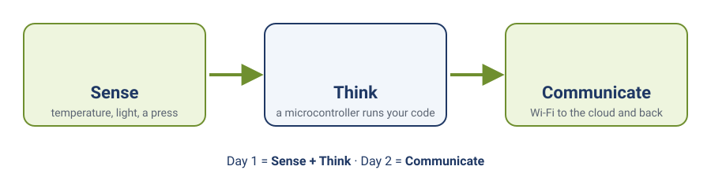
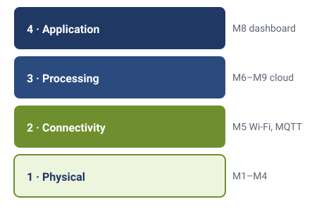

# Module 0 — Introduction to IoT

**Goal:** Build the mental model needed before writing any firmware — what IoT actually is, how an IoT system is layered, which component categories you'll work with, and why this course uses PlatformIO.

**Audience:** No prior embedded or IoT experience required. Basic programming concepts (variables, loops, functions) are helpful but not assumed.

**Estimated time:** 30–45 minutes (reading only — no hardware yet)

**Deliverable:** PlatformIO installed and verified working. You can name the four IoT layers and place any given piece of hardware or software into the correct one.

---

## 1. What Is IoT?

The Internet of Things sounds complicated. It isn't.

At its core, IoT is one idea: take a physical object — a room, a machine, a plant pot — attach **sensors** so it can *sense* the world, add a small computer so it can *think*, give it a wireless radio so it can *communicate*, and that object is now alive on the network.

**Sense. Think. Communicate.** That's the whole model.


*Sense, think, communicate. Day 1 of the course covers the first two; Day 2 adds the third.*

The "internet" part just means these devices talk to each other, to servers in the cloud, or to apps on a phone — without a person manually carrying data between them.

### Concrete example

Without IoT: a farmer walks into a greenhouse every morning, reads a thermometer, and decides by hand whether to open the vents.

With IoT: a microcontroller reads a temperature sensor every 60 seconds, sends the reading to a server, and the server automatically opens a motorized vent if the temperature crosses a threshold — at 3 AM, with no one in the building.

The value isn't the sensor and it isn't the cloud dashboard on its own — it's that **the loop from sensing to action happens automatically, continuously, at scale**. One device doing this is a gadget. A thousand devices doing this is IoT.

---

## 2. The Four-Layer Model

Every IoT system, no matter how simple or complex, is built from four stacked layers.


*The four layers, and the modules that work in each one.*

| Layer | What it is | Examples | Where it lives in this course |
|-------|-----------|----------|-------------------------------|
| **1. Physical** | The hardware you can touch: sensors, actuators, the MCU connecting them | DS18B20, LED, relay, SSN32 | Modules 1–4 |
| **2. Connectivity** | How data moves between the device and everything else | Wi-Fi, Bluetooth, LoRa, Zigbee | Modules 5–6 |
| **3. Processing** | Where data is stored, filtered, and made sense of — cloud or edge | MQTT brokers, databases, APIs, edge processing on the MCU itself | Modules 5–9 (ssc-client, SSC platform) |
| **4. Application** | What the end user actually sees | Dashboards, mobile apps, phone alerts | Module 8 (SSC dashboard) |

**Layer 1 — Physical.** A temperature sensor measures heat. A moisture sensor measures soil water content. An LED or a motor is an **actuator** — something that acts on the physical world. The microcontroller is the brain sitting between sensors and actuators.

**Layer 2 — Connectivity.** Each wireless protocol trades off range, power consumption, and bandwidth differently. A sensor on a desk can use Wi-Fi. A sensor three kilometers from the nearest router needs LoRa instead.

**Layer 3 — Processing.** Data arrives from potentially hundreds of devices. Something has to store it, filter it, and act on it — that's a cloud server or message broker (MQTT brokers, databases, APIs). Some processing also happens directly on the microcontroller — this is called **edge processing**, and it comes up again in later modules (e.g. the rolling average in [module-03-sensors](module-03-sensors.md)).

**Layer 4 — Application.** This is the human interface to everything below: a dashboard, a mobile app, an alert on a phone.

Most of the hands-on work in this course lives in Layers 1 and 2 through Module 4, then moves into Layers 3 and 4 from Module 5 onward via the SSC platform.

---

## 3. Component Categories

Three categories of hardware recur constantly in IoT work.

### Microcontrollers (MCUs)

Tiny computers — no screen, no keyboard, usually no operating system. They run one program, loop forever, and talk directly to peripherals. This course uses the **SSN32** — Sensornode's ESP32-based development board: built-in Wi-Fi and Bluetooth, two processor cores, 3.3 V logic, designed for rapid IoT prototyping. See [module-01-mcu-toolchain-serial](module-01-mcu-toolchain-serial.md) for the full MCU-vs-PC-vs-SBC comparison.

### Sensors

Sensors convert a physical phenomenon into an electrical signal the MCU can read. Temperature, humidity, pressure, light level, soil moisture — there is a sensor for almost everything. Sensors talk to the MCU in two broad ways, and this course covers one of each:

- **Analog** — the sensor outputs a voltage the MCU measures (you'll do this with a potentiometer in [module-03-sensors](module-03-sensors.md)).
- **Digital** — the sensor sends numbers over a small protocol. The DS18B20 temperature sensor used from Module 3 onward uses one called **1-Wire**.

(Other digital protocols like I2C and SPI exist and are extremely common in the wider IoT world — but you don't need them for this course.)

### Actuators

If sensors are inputs, actuators are outputs: relays that switch mains power, servo motors, displays, buzzers. Firmware reads sensor data and decides what actuators to trigger. That cause-and-effect chain is the heartbeat of every IoT project — you'll build a small version of it yourself starting in [module-02-gpio](module-02-gpio.md) (button press → LED behavior change).

---

## 4. Why PlatformIO

This course uses **PlatformIO** — a professional embedded development environment running as a VS Code extension — instead of the classic Arduino IDE.

| Reason | Arduino IDE | PlatformIO |
|--------|-------------|------------|
| Dependency management | Manual `.zip` library hunting | Downloads and pins library versions automatically (`lib_deps`) |
| Multi-board support | One board type configured at a time via Boards Manager | One tool, one workflow, across ESP32, STM32, AVR, and dozens of other platforms |
| Configuration | Scattered across IDE menus | Everything — board, framework, libraries, compiler flags — lives in one version-controllable `platformio.ini` file |

When you open a PlatformIO project, it already knows which chip you're targeting, which toolchain to use, and how to flash firmware over USB. It handles the repetitive setup so you can focus on the actual problem. You'll create your first PlatformIO project in [module-01-mcu-toolchain-serial](module-01-mcu-toolchain-serial.md).

---

## 5. Course Roadmap

```
Module 0    Introduction to IoT                          ← you are here
──────────────────────────────────────────────
Module 1    MCU, Toolchain & Serial
Module 2    GPIO: Output & Input
Module 3    Sensors: Analog & Digital
Module 4    Firmware Patterns & Code Structure
──────────────────────────────────────────────
Module 5    Connect with the SSC Template
Module 6    MQTT & SSC Device Registration
Module 7    Wire Your Parts, See Real Data
Module 8    SSC Dashboard Walkthrough & Widget Creation
Module 9    Control the Device from the Cloud
──────────────────────────────────────────────
Module 10   OTA Firmware Update (bonus)
Reference   Swap Your Parts: any part that fits the role
```

Modules 1–4 stay in Layers 1–2 (physical hardware, wiring, non-blocking firmware). Modules 5–9 move up into Layers 3–4 (connectivity to the ssc-client and the SSC cloud platform, dashboards, remote commands). Module 10 is an optional advanced bonus covering over-the-air firmware updates.

Each module is short and focused, and ends with something that actually works — a blinking LED, a live sensor reading, a cloud dashboard, a remotely-triggered firmware update.

---

## 6. Setup Task — Install PlatformIO

Before Module 1, install the toolchain:

1. Install **Visual Studio Code** from `code.visualstudio.com`
2. Open VS Code → **Extensions** (`Ctrl+Shift+X`) → search **PlatformIO IDE** → **Install**
3. Wait for PlatformIO to download its core tools on first run (a few minutes) and restart VS Code when prompted
4. Confirm the PlatformIO home icon (🏠) appears in the left sidebar

Full driver setup (Windows CP210x/CH340 USB-to-serial) and your first working project are covered in [module-01-mcu-toolchain-serial](module-01-mcu-toolchain-serial.md) — this module only needs the extension installed and opening without errors.

**Your hardware kit.** No hardware is needed for Module 0, but before Module 1 check your kit against the full parts list — the SSN32 board, DS18B20, LED, button module, potentiometer, breadboard, resistors, and jumper wires — in the [project-setup-guide](project-setup-guide.md) ("Check your kit"). The labs name one part for each job, but any part that does the same job works: see [swap-your-parts](swap-your-parts.md).

---

## 7. Deliverable Checklist

- [ ] You can state the four IoT layers in order and give one example of each
- [ ] You can explain the difference between a sensor and an actuator
- [ ] You can name the MCU used in this course and one reason to prefer it over a Raspberry Pi for this work
- [ ] You can give one concrete reason PlatformIO is used instead of the Arduino IDE
- [ ] VS Code is installed with the PlatformIO extension, and it opens without errors

---

## 8. What's Next

In **[module-01-mcu-toolchain-serial](module-01-mcu-toolchain-serial.md)** you will:
- Compare MCU vs PC vs single-board computer in depth
- Set up your first PlatformIO project targeting the SSN32
- Use Serial as your primary debug tool
- Build a `millis()`-based uptime printer lab

