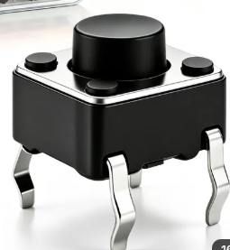

# Module 2 — GPIO: Output & Input

**Goal:** Control and read physical hardware from code — blink an LED and read a push button reliably.

**Audience:** Completed [module-01-mcu-toolchain-serial](module-01-mcu-toolchain-serial.md).

**Estimated time:** 2–3 hours (reading + lab)

**Deliverable:** LED blinks using `millis()` (no `delay()`). Button press toggles blink rate with debouncing. Serial confirms each press.

---

## 1. What Is a GPIO Pin?

**GPIO** stands for General Purpose Input/Output. Each GPIO pin on the SSN32 is a physical connection point that you can configure in firmware to either:

- **OUTPUT** — drive the pin HIGH (3.3 V) or LOW (0 V) to power something
- **INPUT** — read whether external circuitry is pulling the pin HIGH or LOW

GPIO pins are how the MCU connects to the real world: they drive LEDs, control relay coils, read button states, and communicate with sensors.

### On/off (digital) parts in your kit

A **digital** part has only two states: on or off, pressed or released, HIGH or LOW. This module wires the first two rows; the others work the same way and show where the idea goes in real devices.

| Part | Direction | What it does | Where you'd use it |
|------|-----------|--------------|--------------------|
| **LED** | Output | Lights when the pin is HIGH | Status light: "online", "alarm active" |
| **4-leg tactile switch** | Input | Joins two legs while pressed | Reset, mode select, "call for service" button |
| **3-pin button module** | Input | A button with its own resistor on a small board | Same jobs, wired with three jumpers |
| **Active buzzer** | Output | Beeps by itself while powered | Door-open alarm, "fridge too warm" beep |
| **RGB LED** | Output | Red, green and blue LEDs in one part, one pin each | One light, several meanings: green OK, red fault |
| **4N35 optocoupler** | Input | Passes an on/off signal through light, with no wire between the two sides | Reading a 12–24 V machine signal ("motor running") without connecting it to the 3.3 V board |

> The buzzer needs more current than a GPIO pin should give, so a transistor (also in the kit) switches it and the pin only tells the transistor when to beep. You can build it at the end of the lab: "Go further — make it beep".

### Voltage levels on the SSN32

Every GPIO pin operates at **3.3 V logic**. HIGH = 3.3 V, LOW = 0 V. Never connect a 5 V signal to a GPIO pin without level shifting — it will damage the chip.

---

## 2. Controlling an LED (Output)

### Ohm's law and the current-limiting resistor

An LED will draw as much current as the circuit allows. Without a resistor, it pulls far more than the pin can safely give (keep each ESP32 pin to about **20 mA**; 40 mA is its absolute maximum) and can damage the LED and the pin.

Use a **220 Ω resistor** in series with the LED:

```
GPIO 2 ──[220Ω]──[LED anode → cathode]──> GND
```

Ohm's law: `I = V / R`. The LED itself always takes about 2 V, so the resistor only gets the rest:  
`(3.3 V − 2 V) / 220 Ω ≈ 6 mA`: bright enough to see, and well within the pin limit.

### pinMode and digitalWrite

```cpp
pinMode(2, OUTPUT);      // configure GPIO 2 as output
digitalWrite(2, HIGH);  // set pin HIGH (LED on)
digitalWrite(2, LOW);   // set pin LOW  (LED off)
```

Call `pinMode()` in `setup()`. Call `digitalWrite()` any time you want to change the state.

---

## 3. The Problem With delay()

The natural first instinct for blinking an LED:

```cpp
void loop() {
    digitalWrite(LED_PIN, HIGH);
    delay(500);
    digitalWrite(LED_PIN, LOW);
    delay(500);
}
```

This works, but it is **fatally wrong for real firmware**. During both `delay(500)` calls, the MCU sits completely frozen — it cannot read a sensor, check a button, communicate over WiFi, or do anything at all. The entire program blocks.

Rule: **never use `delay()` in production firmware**. You will not use it after this module.

---

## 4. Non-Blocking Blink with millis()

The correct pattern uses `millis()` to check elapsed time without blocking:

```cpp
const unsigned long BLINK_INTERVAL = 500;  // ms
unsigned long lastToggle = 0;
bool ledState = false;

void loop() {
    unsigned long now = millis();

    if (now - lastToggle >= BLINK_INTERVAL) {
        lastToggle = now;
        ledState = !ledState;            // flip: false→true, true→false
        digitalWrite(LED_PIN, ledState); // true = HIGH (on), false = LOW (off)
    }

    // everything else here runs at full speed, unblocked
}
```

### How it works

1. `millis()` returns milliseconds since boot — it counts up continuously, never blocking anything
2. `now - lastToggle` is the elapsed time since the last toggle
3. When that exceeds the interval, act and reset `lastToggle`
4. The rest of `loop()` — reading buttons, sensors, etc. — executes every iteration unhindered

> **What is `ledState = !ledState`?** The `!` means **"not"** — it flips a true/false value to its opposite. So each pass swaps `ledState` between `true` and `false`, and the LED goes on, off, on, off… And because `digitalWrite` reads `true` as HIGH (on) and `false` as LOW (off), you can hand it `ledState` directly — no need to spell out `HIGH`/`LOW` yourself.

This is the **fundamental firmware timing pattern**. Every module from here on uses it.

---

## 5. Reading a Button (Input)

### INPUT_PULLUP

When a GPIO is configured as a plain `INPUT` and nothing is connected, the pin floats — it reads random values. The solution is to enable the **internal pull-up resistor**:

```cpp
pinMode(BUTTON_PIN, INPUT_PULLUP);
```

With `INPUT_PULLUP`:
- The pin is held HIGH internally when no button is pressed
- When you press the button and connect the pin to GND, it reads LOW

Wire your button between **GPIO 4** and GND (no external resistor needed):

```
GPIO 4 ──[button]──> GND
```

### Using the kit's 4-leg tactile switch



The small black switch with a round cap and **four legs** (6 × 6 mm) is the most common button in electronics. It has no resistor and no board, so it is exactly the "button to GND" above.

Four legs, but only **two connections**: inside, the legs are joined in pairs. The two legs that **face each other across the body** are always connected; pressing the cap joins the two pairs.

1. Push it into the breadboard **across the centre gap**, like a chip.
2. Use two legs that are **diagonally opposite**. Diagonal legs are always in different pairs, so this works whichever way round the switch sits.
3. One diagonal leg → **GPIO 4**, the other → **GND**.

```
          centre gap
   GPIO 4 ─ ●━━┊━━●        ● = leg, ━━ = always connected inside
               ┊           pressing joins the top pair to the bottom pair
            ●━━┊━━● ─ GND
```

> **Reads "pressed" all the time, or never?** You picked two legs of the same pair (always connected). Use the diagonal, or turn the switch 90°.

> **Why GPIO 4 and not GPIO 0?** GPIO 0 is wired to the SSN32's own **BOOT** button. Holding it while the board starts puts the chip into upload mode, and from Module 5 the Sensorclouds template uses it to open its setup page. Keeping your button on GPIO 4 means you wire it once and it works in every module.

Reading the button:

```cpp
int state = digitalRead(BUTTON_PIN);
// state == HIGH: button released
// state == LOW:  button pressed
```

Note the inverted logic — **LOW means pressed** when using `INPUT_PULLUP`.

### Using the kit's 3-pin button module

Your kit may have a button on a small board with three pins: **GND**, **VCC** and **OUT**. The board already has its own resistor, and most of these modules work the other way round: **OUT is LOW when released and HIGH when pressed.**

| Module pin | Connect to |
|-----------|-----------|
| VCC | 3.3 V |
| GND | GND |
| OUT | GPIO 4 |

In the code, keep `INPUT_PULLUP` and change one line: `#define PRESSED HIGH` instead of `LOW` (the lab code below has this line at the top).

> **Not sure which kind you have?** Put `Serial.println(digitalRead(BUTTON_PIN));` in `loop()`, upload, and watch the Serial Monitor while you press and release. Whatever number shows *while pressed* (0 = LOW, 1 = HIGH) is your `PRESSED` value. Checking a part's behaviour like this, instead of guessing, is a habit worth keeping.

---

## 6. Button Bouncing and Simple Cooldown

Mechanical buttons bounce — when you press one, the contacts make and break dozens of times in the first 5–20 ms. Without handling this, one physical press can register as many presses in code.

The simplest fix: after accepting a press, **ignore the button for the next 200 ms**. One variable is all it takes:

```cpp
#define PRESSED LOW            // plain button to GND (kit 3-pin module: HIGH)
unsigned long lastPressTime = 0;

int raw = digitalRead(BUTTON_PIN);
if (raw == PRESSED && now - lastPressTime >= 200) {
    lastPressTime = now;
    // confirmed press — will not fire again for 200 ms
}
```

This cooldown approach works well for lab bench buttons. Module 4 covers the full software debounce technique — which handles any input signal and also detects release events — as part of its firmware patterns coverage.

---

## 7. Combining Input and Output

Multiple independent tasks run in one `loop()` — each with its own timestamp variable, neither blocking the other:

```cpp
unsigned long lastToggle    = 0;
unsigned long blinkInterval = 500;
unsigned long lastPressTime = 0;
bool          ledState      = false;

void loop() {
    unsigned long now = millis();

    // --- LED blink task ---
    if (now - lastToggle >= blinkInterval) {
        lastToggle = now;
        ledState = !ledState;             // flip on/off
        digitalWrite(LED_PIN, ledState);
    }

    // --- Button task ---
    int raw = digitalRead(BUTTON_PIN);
    if (raw == PRESSED && now - lastPressTime >= 200) {
        lastPressTime = now;
        // toggle the blink rate between 500 ms and 100 ms
        if (blinkInterval == 500) {
            blinkInterval = 100;
        } else {
            blinkInterval = 500;
        }
        Serial.printf("[%lums] press — interval now %lums\n", now, blinkInterval);
    }
}
```

Both tasks run independently. Neither blocks the other.

---

## 8. Lab — LED Blink + Button Toggle

### Hardware

| Component | Connection |
|-----------|-----------|
| LED (anode) | GPIO 2 via 220 Ω resistor |
| LED (cathode) | GND |
| 4-leg tactile switch, one leg | GPIO 4 |
| The diagonally opposite leg | GND |

*(Kit 3-pin button module instead: VCC → 3.3 V, GND → GND, OUT → GPIO 4, and set `PRESSED` to `HIGH`.)*

> **Bonus:** GPIO 2 is also connected to the SSN32's **on-board LED**, so the small LED on the board blinks together with yours. If only the on-board one blinks, check your LED's direction (long leg = anode, towards GPIO 2) and the resistor.

### Complete code

```cpp
#include <Arduino.h>

#define LED_PIN    2
#define BUTTON_PIN 4
#define PRESSED    LOW   // plain button to GND. Kit 3-pin module: HIGH

unsigned long lastToggle    = 0;
unsigned long blinkInterval = 500;
unsigned long lastPressTime = 0;
bool          ledState      = false;

void setup() {
    Serial.begin(115200);
    pinMode(LED_PIN, OUTPUT);
    pinMode(BUTTON_PIN, INPUT_PULLUP);
    Serial.println("Module 2 ready.");
}

void loop() {
    unsigned long now = millis();

    // LED blink
    if (now - lastToggle >= blinkInterval) {
        lastToggle = now;
        ledState = !ledState;             // flip on/off
        digitalWrite(LED_PIN, ledState);
    }

    // Button press with cooldown
    int raw = digitalRead(BUTTON_PIN);
    if (raw == PRESSED && now - lastPressTime >= 200) {
        lastPressTime = now;
        // toggle the blink rate between 500 ms and 100 ms
        if (blinkInterval == 500) {
            blinkInterval = 100;
        } else {
            blinkInterval = 500;
        }
        Serial.printf("[%lums] press — interval now %lums\n", now, blinkInterval);
    }
}
```

### Build and upload

1. Click **→ Upload** in the bottom bar (Windows: `Ctrl+Alt+U`)
2. Click **🔌 Serial Monitor** (Windows: `Ctrl+Alt+S`)
3. Press **EN** on the SSN32 to restart it and see the first lines

### Expected behaviour

- LED blinks at 500 ms by default
- Each button press toggles between 500 ms and 100 ms
- Serial prints one confirmation line per confirmed press (not per bounce)

### Troubleshooting

| Symptom | Cause | Fix |
|---------|-------|-----|
| LED stays on/off | Wrong pin or missing resistor | Check wiring and `LED_PIN` constant |
| Multiple prints per press | Cooldown too short | Increase from `200` to `300` ms |
| LED doesn't blink (just on) | `lastToggle` not updating | Ensure `lastToggle = now;` is inside the `if` |
| Button does nothing | `INPUT_PULLUP` not set, or wrong pin | Check `pinMode(BUTTON_PIN, INPUT_PULLUP)` and that the wire is on GPIO 4 |
| Rate keeps toggling by itself, or only changes when you *release* | `PRESSED` is the wrong level for your button | Swap `PRESSED` between `LOW` and `HIGH` (see "Using the kit's 3-pin button module") |
| 4-leg switch: rate toggles by itself every 200 ms, or never | GPIO 4 and GND are on two legs of the same pair (always connected), or the switch isn't across the centre gap | Use two **diagonally opposite** legs, with the switch across the centre gap |

### Go further — make it beep (active buzzer + transistor)

Swap the LED for the kit's **active buzzer** (a **Digisound F/TCW05**: a small black cylinder, Ø 12 mm, with `+` marked on top) and your blink becomes a beep, with no code change. The button still switches between slow and fast beeps. It is loud (about 88 dB at 10 cm), so in class keep the test short.

**Why not wire the buzzer straight to the pin like the LED?** The F/TCW05 takes up to **30 mA**, more than a GPIO pin should give (about 20 mA). Things that need more current than a pin can give (buzzers, relays, motors, LED strips) are switched with a **transistor**: a tiny current from the pin into the transistor's **base** lets a much bigger current flow from its **collector** to its **emitter**, through the buzzer. The pin gives under 1 mA; the buzzer's current never goes through the ESP32.

```
3.3 V ──────────┬────────────┐
                │            │
           buzzer +       1N4007   stripe end at the top (towards +)
          (F/TCW05)          │
           buzzer −          │
                │            │
                └─────┬──────┘
                      │
                      C  collector ┐
                                   │  NPN transistor
GPIO 2 ──[ 5.1 kΩ ]── B  base      │  (2N2222A)
                                   │
GND ───────────────── E  emitter   ┘
```

1. **The transistor:** your kit's is a **2N2222A**, an **NPN** type (the print is on its flat face). Other NPN parts such as `S8050` work the same; PNP parts such as `S8550` won't work in this circuit.
2. **Find its legs.** Flat face towards you, legs down: **E B C** from left to right (emitter, base, collector).
3. **Base resistor:** the kit's **5.1 kΩ** works; **1 kΩ**, if you have one, switches the buzzer's full 30 mA with more margin. Never connect the base straight to the pin.
4. **Buzzer:** `+` to 3.3 V, the other leg to the collector. Its legs are 7.6 mm apart, so they sit 3 breadboard holes apart. An active buzzer like the F/TCW05 has a sealed bottom; one with the circuit board showing underneath is the *passive* kind, which only clicks here.
5. **Diode:** put the kit's **1N4007** across the buzzer, its **stripe towards `+`**. The F/TCW05 is an *electromagnetic* buzzer: there is a small coil inside, and when a coil switches off it kicks back a voltage spike. The diode soaks it up so it can't damage the transistor. Relays and motors have coils too and need the same diode.

> **Louder?** The F/TCW05 is rated **5 V** (it works from 3 V to 7 V), so on 3.3 V it is quieter than it can be. If your SSN32 has a **5V** pin, put the buzzer's `+` (and the diode's stripe) there instead. The 5 V only flows through the buzzer and the transistor, never into the GPIO pin, so this is safe.

| Symptom | Likely cause | Fix |
|---------|--------------|-----|
| Silent, or very quiet | Transistor legs in the wrong order | Flat face towards you: E B C, left to right |
| Beeps all the time | Buzzer's other leg on GND instead of the collector, or the base wired to 3.3 V | The buzzer goes to C only; the base goes only through the resistor to GPIO 2 |
| Only clicks | It's the passive buzzer | Use the one with the sealed bottom |

---

## 9. Deliverable Checklist

- [x] LED blinks at 500 ms on power-up (no `delay()` in code)
- [x] Button press toggles blink rate between 500 ms and 100 ms
- [x] No repeated triggers — one physical press = one Serial print
- [x] You can explain why `delay()` is a problem and how `millis()` solves it
- [x] You can explain what button bouncing is and why a cooldown timer prevents false triggers

---

## 10. What's Next

In **[module-03-sensors](module-03-sensors.md)** you will:
- Read analog signals with the ADC (`analogRead`)
- Wire and read the DS18B20 temperature sensor using the 1-Wire protocol
- Run two independent sensor reads in one `loop()` without blocking

