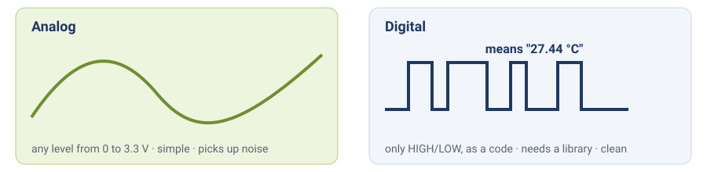
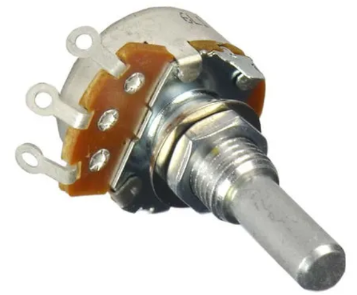
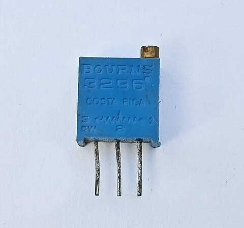
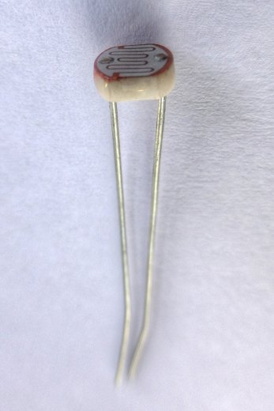
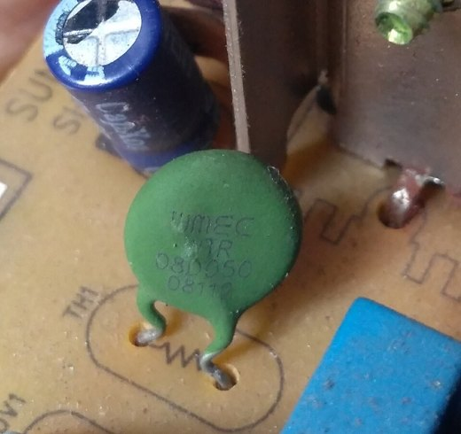
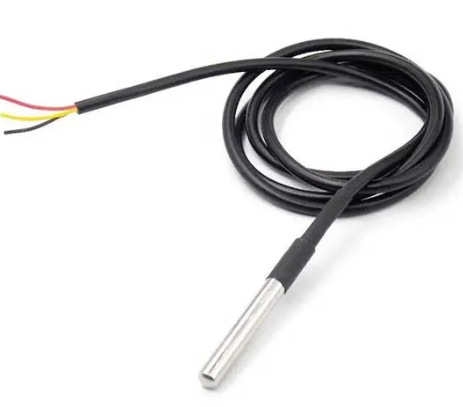
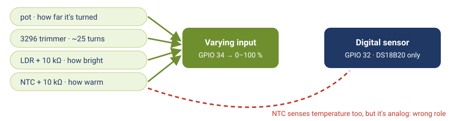
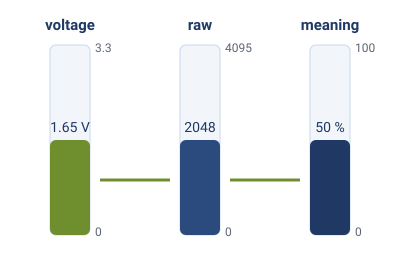
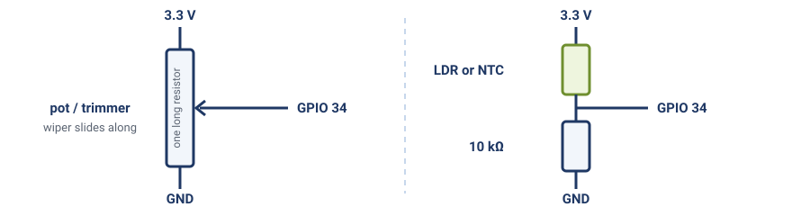
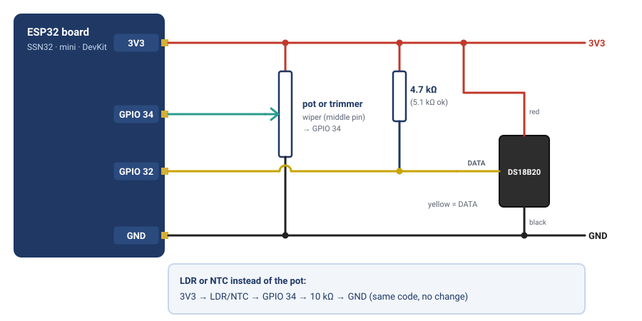

# Module 3 — Sensors: Analog & Digital

**Goal:** Read both analog and digital sensors, understand the difference between them, and wire up the DS18B20 temperature sensor used in all subsequent modules.

**Audience:** Completed [module-02-gpio](module-02-gpio.md).

**Estimated time:** 2–3 hours (reading + lab)

**Deliverable:** Smooth analog percentage from your analog part (potentiometer, trimmer, LDR or thermistor) and live DS18B20 temperature readings — both running in one `loop()` with no blocking.

---

## 1. Analog vs Digital Sensors

| Property   | Analog                          | Digital                                            |
| ---------- | ------------------------------- | -------------------------------------------------- |
| Output     | Continuous voltage (0–3.3 V)    | Discrete values over a protocol (1-Wire, I2C, SPI) |
| Resolution | Limited by ADC                  | Set in sensor firmware (9–12 bit for DS18B20)      |
| Noise      | Susceptible to electrical noise | Immune — data is encoded                           |
| Wiring     | One signal wire                 | One or two signal wires; more complex protocol     |
| Examples   | LDR, potentiometer, thermistor  | DS18B20, BME280, DHT22                             |


*Analog: a voltage whose level means something. Digital: a coded message of HIGHs and LOWs.*

Analog sensors are simple to wire but produce noisy readings. Digital sensors require a library but give clean, calibrated data. The DS18B20 is the right choice for temperature in IoT applications — it is accurate to ±0.5 °C out of the box.

### Sensors in your kit

The lab uses the potentiometer and the DS18B20. The kit has more, and each one shows a different side of analog vs digital:

| Part | Type | What it tells you | Extra part needed | Where you'd use it |
|------|------|-------------------|-------------------|--------------------|
| **Potentiometer** (knob) or **3296 trimmer** (blue box, brass screw) | Analog | A position: how far it's turned | **None**: it is already a voltage divider (Section 2) | Knob: a setpoint ("keep the room at 25 °C"). Trimmer: a set-once adjustment with a screwdriver, e.g. a sensor's sensitivity |
| **LDR** (light-dependent resistor) | Analog | Light level | **10 kΩ** resistor | Street lights that switch on at dusk, screen auto-brightness |
| **NTC thermistor** | Analog | Temperature, roughly: its resistance falls as it warms | **10 kΩ** resistor | Cheap temperature sensing in kettles, battery packs, 3D printers. Needs a formula and calibration to give °C |
| **DS18B20** | Digital (1-Wire) | Temperature in °C, already calibrated | 4.7 kΩ pull-up | Cold rooms, aquariums, compost: the course's main sensor |
| **Push button** | Digital | Pressed or not | None (`INPUT_PULLUP`, Module 2) | Any "a person did something" input |

|  |  |  |  |  |
|:---:|:---:|:---:|:---:|:---:|
| potentiometer | 3296 trimmer | LDR | NTC thermistor | DS18B20 |

The thermistor and the DS18B20 both measure temperature: one is analog and cheap, the other is digital and accurate. The swap at the end of the lab lets you compare them side by side.

### Same role, same code

Like Module 2, think in **roles**. GPIO 34 is the **varying input** role: the code reads a voltage from 0 to 3.3 V and turns it into 0–100 %. The potentiometer, the trimmer, the LDR and the thermistor all make such a voltage, so **all four work with the same code**. Only what the percentage *means* changes: how far it's turned, how bright, how warm.


*Four parts fit the varying-input job on GPIO 34. The NTC senses temperature too, but it cannot replace the DS18B20.*

GPIO 32 is a different role: the **digital sensor** bus. The DS18B20 sends coded messages, not a voltage, so the thermistor can't replace it there even though both measure temperature. Swap within a role, not across roles. Wiring for every option: [swap-your-parts](swap-your-parts.md).

---

## 2. ADC: Reading Analog Signals

The **ADC (Analog-to-Digital Converter)** on the ESP32 converts a voltage (0–3.3 V) to a 12-bit integer (0–4095).

```cpp
int raw = analogRead(34);   // returns 0–4095
```

### Mapping raw values

To convert a raw ADC reading to a percentage (0–100 %):

```cpp
float percent = (analogRead(34) / 4095.0f) * 100.0f;
```

Use `4095.0f` (not `4095`) to force floating-point division.


*The same reading three ways: the voltage on the pin, the raw ADC number, and what it means.*

### Voltage dividers: why the pot needs no extra resistor

The ADC measures a **voltage**, so an analog sensor has to turn what it senses into one. Two resistors in series between 3.3 V and GND do that: the voltage at the point between them depends on how the 3.3 V is shared between the two. That is a **voltage divider**.

- A **potentiometer or trimmer** *is* a divider already: one long resistor between its outer pins, and the wiper slides along it. Wiper straight to GPIO 34, outer pins to 3.3 V and GND, **no extra resistor**.
- An **LDR** or **thermistor** is only *one* resistor that changes. Add a fixed **10 kΩ** as the second half:


*Left: a pot is a complete divider. Right: an LDR or NTC needs a fixed 10 kΩ as its other half.*

With the sensor on top, more light (LDR) or more heat (NTC) lowers its resistance, so more of the 3.3 V reaches GPIO 34 and the percentage **rises**. Swap the two parts and it falls instead. Both are fine; you just read it the other way round.

### ESP32 ADC caveats

- Only certain pins support ADC: GPIO 32–39 on the SSN32 (use GPIO 34 for input-only analog reads)
- **ADC2 pins (GPIO 0, 2, 4, 12–15, 25–27) are unavailable when Wi-Fi is active** — use ADC1 pins (32–39) for anything that runs alongside Wi-Fi
- The ESP32 ADC has non-linearity at the edges (near 0 V and near 3.3 V). Do not rely on readings below ~100 mV or above ~3.1 V for precise measurements

---

## 3. Noise and Averaging

ADC readings fluctuate due to electrical noise. A single raw reading may jump ±20–50 counts. Use a **rolling average** to smooth the signal:

```cpp
const int NUM_SAMPLES = 10;
int samples[NUM_SAMPLES] = {};
int sampleIndex = 0;

void readAnalog() {
    samples[sampleIndex] = analogRead(34);
    sampleIndex = (sampleIndex + 1) % NUM_SAMPLES;   // next slot; wraps 9 → 0

    long sum = 0;
    for (int i = 0; i < NUM_SAMPLES; i++) sum += samples[i];
    float avg = sum / (float)NUM_SAMPLES;

    float percent = (avg / 4095.0f) * 100.0f;
    Serial.printf("[%lums] pot: %.1f%%\n", millis(), percent);
}
```

> **What is `% NUM_SAMPLES`?** `%` gives the **remainder** of a division. Here it keeps `sampleIndex` cycling `0, 1, 2, … 9, 0, 1, …` so we always overwrite the *oldest* of the 10 stored readings — a "rolling" window of the last 10 samples. Without the wrap, the index would keep growing and run off the end of the array.

Calling `readAnalog()` every 50–100 ms fills the buffer quickly and produces a stable reading within the first second.

---

## 4. Digital Sensors and 1-Wire

The **DS18B20** communicates over the **1-Wire** protocol — a single data line that carries both power and data. Several sensors can share one wire, each identified by its own unique 64-bit ROM address (the course code reads just the first one).

### Why 1-Wire for temperature?

- One GPIO pin can read several sensors
- Data is noise-immune (digital encoding)
- Factory-calibrated: no user calibration required
- Wide range: −55 °C to +125 °C; ±0.5 °C accuracy from −10 to +85 °C

### Wiring

```
SSN32 3.3V ──────────────────── DS18B20 VCC (red)
                │
               [4.7kΩ]          ← pull-up resistor (required)
                │
SSN32 GPIO 32 ──┤─────────────── DS18B20 DATA (yellow)

SSN32 GND ──────────────────── DS18B20 GND (black)
```

The 4.7 kΩ pull-up between VCC and DATA is **required** — without it, the bus has no defined idle state and communication will fail.

> **Your kit has 5.1 kΩ instead of 4.7 kΩ?** Use it. A pull-up only needs to be "roughly a few kΩ" to hold the line HIGH, and 5.1 kΩ works exactly the same on a short wire like this. (Colour bands: 4.7 kΩ starts yellow-violet, 5.1 kΩ starts green-brown.)

---

## 5. OneWire and DallasTemperature Libraries

Add both libraries to `platformio.ini`:

```ini
lib_deps =
    paulstoffregen/OneWire @ ^2.3.8
    milesburton/DallasTemperature @ ^3.11.0
```

### Usage

```cpp
#include <Arduino.h>
#include <OneWire.h>
#include <DallasTemperature.h>

#define DS18B20_PIN 32

OneWire oneWire(DS18B20_PIN);
DallasTemperature sensors(&oneWire);

void setup() {
    Serial.begin(115200);
    sensors.begin();
    sensors.setResolution(12);  // 12-bit: 0.0625 °C steps, 750 ms conversion
}

void loop() {
    sensors.requestTemperatures();          // trigger conversion
    float tempC = sensors.getTempCByIndex(0);  // read first sensor

    if (tempC == DEVICE_DISCONNECTED_C) {
        Serial.println("[error] DS18B20 not found");
    } else {
        Serial.printf("[%lums] temp: %.2f C\n", millis(), tempC);
    }

    delay(2000);  // will be replaced with millis() in the lab
}
```

### Resolution vs conversion time

| Resolution | Step size | Conversion time |
|------------|-----------|----------------|
| 9-bit | 0.5 °C | 94 ms |
| 10-bit | 0.25 °C | 188 ms |
| 11-bit | 0.125 °C | 375 ms |
| 12-bit | 0.0625 °C | 750 ms |

`requestTemperatures()` is a **blocking** call for the duration of the conversion. In the lab you will make it non-blocking using millis().

---

## 6. Non-Blocking Sensor Reads

`requestTemperatures()` normally **blocks** for the full conversion time — 750 ms at 12-bit. That freezes the entire loop. The fix is one setup call:

```cpp
sensors.setWaitForConversion(false);  // call once in setup()
```

With this set, `requestTemperatures()` returns immediately after triggering the conversion. The loop keeps running. You check back 800 ms later to collect the result.

Use a **bool flag** to track whether a conversion is in progress:

```cpp
bool          tempPending     = false;
unsigned long tempRequestedAt = 0;
unsigned long lastTempCycle   = 0;

// Trigger a new conversion every 2 s
if (now - lastTempCycle >= 2000) {
    lastTempCycle = now;
    sensors.requestTemperatures();
    tempPending     = true;
    tempRequestedAt = now;
}

// Read result 800 ms after triggering (12-bit conversion takes at most 750 ms)
if (tempPending && now - tempRequestedAt >= 800) {
    tempPending = false;
    float tempC = sensors.getTempCByIndex(0);
    // use tempC
}
```

Two events per 2-second cycle: trigger at the top, read 800 ms later. The loop is free the entire time.


*Ask now, read later: the conversion runs on its own while the loop keeps going.*

---

## 7. Lab — Analog Input + DS18B20

### Hardware

**Analog input (GPIO 34): pick one.** The code is the same for all of them.

| Part | Connection | Extra part |
|------|-----------|------------|
| Potentiometer (knob) | Middle leg (wiper) → GPIO 34; outer legs → 3.3 V and GND | None |
| *or* 3296 trimmer | Same: middle pin → GPIO 34; outer pins → 3.3 V and GND (see the box below) | None |
| *or* LDR | 3.3 V → LDR → GPIO 34 → 10 kΩ → GND | 10 kΩ |
| *or* NTC thermistor | 3.3 V → NTC → GPIO 34 → 10 kΩ → GND | 10 kΩ |


*Lab wiring: the pot on GPIO 34, the DS18B20 on GPIO 32 with its pull-up.*

**Digital sensor (GPIO 32):**

| Component | Connection |
|-----------|-----------|
| DS18B20 VCC | 3.3 V |
| DS18B20 DATA | GPIO 32 (with 4.7 kΩ to 3.3 V) |
| DS18B20 GND | GND |

> **Got a small blue box with a brass screw instead of a knob?** That's a **multi-turn trimmer** (e.g. 3296W). The code on top gives its value: `W202` = 2 kΩ, `103` = 10 kΩ. Any of these works. Its three pins are in a row and the **middle pin is the wiper**: it goes **straight to GPIO 34, no resistor needed**; the outer pins go to 3.3 V and GND. Two things are different from a knob:
> - It takes about **25 full turns** of the screw to go from 0 % to 100 %. A few turns may barely move the reading.
> - It has **no end stop**. At either end it keeps turning without changing anything, so "it turns but nothing happens" usually means you're at an end: turn the other way.
>
> If it still reads the same after 25+ turns each way, check it with a multimeter (power off): about the printed value between the two outer pins, and a changing value from the middle pin to one outer pin while you turn. If not, the trimmer is broken; swap it.

### platformio.ini

```ini
[env:esp32dev]
platform = espressif32
board = esp32dev
framework = arduino
lib_deps =
    paulstoffregen/OneWire @ ^2.3.8
    milesburton/DallasTemperature @ ^3.11.0
```

### Complete code

```cpp
#include <Arduino.h>
#include <OneWire.h>
#include <DallasTemperature.h>

#define POT_PIN    34
#define DS18B20_PIN 32

OneWire oneWire(DS18B20_PIN);
DallasTemperature sensors(&oneWire);

// Rolling average for ADC
const int NUM_SAMPLES = 10;
int adcBuf[NUM_SAMPLES] = {};
int adcIdx = 0;

// Timers and DS18B20 state
unsigned long lastPotRead     = 0;
unsigned long lastTempCycle   = 0;
unsigned long tempRequestedAt = 0;
bool          tempPending     = false;

float smoothedPercent = 0.0f;

void setup() {
    Serial.begin(115200);
    sensors.begin();
    sensors.setResolution(12);
    sensors.setWaitForConversion(false);  // makes requestTemperatures() return immediately
    Serial.println("Module 3 ready.");
}

void loop() {
    unsigned long now = millis();

    // --- Part A: potentiometer (every 100 ms) ---
    if (now - lastPotRead >= 100) {
        lastPotRead = now;
        adcBuf[adcIdx] = analogRead(POT_PIN);
        adcIdx = (adcIdx + 1) % NUM_SAMPLES;   // next slot; wraps 9 → 0

        long sum = 0;
        for (int i = 0; i < NUM_SAMPLES; i++) sum += adcBuf[i];
        smoothedPercent = (sum / (float)NUM_SAMPLES / 4095.0f) * 100.0f;

        Serial.printf("[%lums] pot: %.1f%%\n", now, smoothedPercent);
    }

    // --- Part B: DS18B20 (every 2 s) ---
    if (now - lastTempCycle >= 2000) {
        lastTempCycle = now;
        sensors.requestTemperatures();  // returns immediately (setWaitForConversion false)
        tempPending     = true;
        tempRequestedAt = now;
    }

    if (tempPending && now - tempRequestedAt >= 800) {
        tempPending = false;
        float tempC = sensors.getTempCByIndex(0);
        if (tempC == DEVICE_DISCONNECTED_C) {
            Serial.printf("[%lums] DS18B20: not found\n", now);
        } else {
            Serial.printf("[%lums] temp: %.2f C\n", now, tempC);
        }
    }
}
```

### Expected Serial output

```
Module 3 ready.
[100ms]  pot: 47.3%
[200ms]  pot: 47.5%
...
[2000ms] temp: 28.43 C
[2100ms] pot: 52.1%
...
[4000ms] temp: 28.44 C
```

Both sensors report independently. Neither blocks the other.

### Swap the analog part — LDR or thermistor

No code change: the program reads whatever voltage is on GPIO 34. Take the potentiometer out and build the divider from Section 2 instead (sensor from 3.3 V to GPIO 34, **10 kΩ** from GPIO 34 to GND).

| Part on GPIO 34 | Do this | You should see |
|-----------------|---------|----------------|
| LDR | Cover it with a finger, then shine a phone torch on it | The percentage drops close to 0, then climbs high |
| NTC thermistor | Hold it between two fingers for 20 s | The percentage rises a few points, slowly. Hold the DS18B20 at the same time: its °C rises too |

The thermistor shows the trade-off from Section 1: it reacts to heat, but "57 %" is not a temperature. Turning it into °C needs the part's datasheet, a formula and a calibration against a real thermometer. The DS18B20 gives °C directly, which is why the course uses it.

Keep whichever part you like: Module 4 reuses this code, and from Module 7 the template reads GPIO 34 the same way. (From Module 7 the template publishes whatever is on GPIO 34 as `pot`. With the LDR, that puts the light level on your dashboard; just title the widget "Light level".)

---

## 8. Deliverable Checklist

- [x] Your analog part (pot, trimmer, LDR or thermistor) prints a rolling average as a percentage every 100 ms
- [x] DS18B20 temperature prints every 2 seconds
- [x] Both run in the same `loop()` with no `delay()`
- [x] No `DEVICE_DISCONNECTED_C` errors (sensor is wired correctly with pull-up)
- [x] You can explain why the 4.7 kΩ pull-up is required
- [x] You can explain why the LDR needs a 10 kΩ but the pot doesn't, and why the thermistor can't replace the DS18B20 on GPIO 32

---

## 9. What's Next

In **[module-04-firmware-patterns](module-04-firmware-patterns.md)** you will:
- Split this project into tidy files (`sensors.h/.cpp`, `led.h/.cpp`) using plain functions — so `main.cpp` reads like a summary
- Replace hardcoded pin numbers with `platformio.ini` build flags
- Run three independent timed tasks in a clean, readable `loop()`

