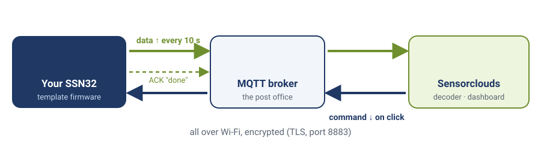
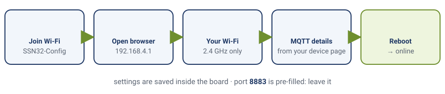

# Module 5 — Connect with the SSC Template

**Goal:** Get your SSN32 **online** in the SSC (Sensorclouds) platform and keep it there — by flashing a ready-made **template** and configuring it in your browser. You write almost no code.

**Audience:** Completed [module-04-firmware-patterns](module-04-firmware-patterns.md). This is your first "online" module.

**Estimated time:** 1.5–2 hours.

**Deliverable:** Your device connects on power-up, publishes its readings every 10 seconds, and **stays online** in the SSC dashboard — all configured through a web wizard, no credentials in code.

> **Instructor note:** the payoff here is a board that shows up green *and stays green*. That "stays" matters: a device that only connects but never publishes gets marked offline after 90 seconds without a message (1.5 × the Device Profile's 60 s keep-alive) — which is exactly why we use the template (it publishes on a timer). Have the SSC dashboard projected. The #1 snag is joining the config Wi-Fi hotspot; Section 6 is the triage guide.

---

## 1. The idea: configure, don't code

Up to now you wrote every line. Connecting a device to a cloud platform properly means a *lot* of plumbing: Wi-Fi with auto-reconnect, an MQTT client, a birth/offline announcement, publishing telemetry on a schedule, receiving commands, and over-the-air updates. Writing all of that by hand is error-prone.


*The whole system: data goes up on a timer, commands come down when someone clicks, and the board confirms each one.*

So instead you use the **SSC template** — a ready-made firmware (called `SSCApp`) that already contains all of it. Your job is not to *write* it, but to:

1. **Flash** the template to your board.
2. **Configure** it (Wi-Fi + your SSC credentials) in a web wizard.
3. (Module 7) **wire your parts** to it. The code that reads them is already inside.

That's the real way devices are built — you stand on a tested library, not a blank file.

> **Curious what's inside?** The appendix [appendix-under-the-hood-ssc-client](appendix-under-the-hood-ssc-client.md) shows how to drive the low-level `SSCClient` by hand. Optional — come back to it after the course.

---

## 2. What the whole program looks like

Open the template's `src/main.cpp`. This is the **entire** sketch:

```cpp
#include <Arduino.h>
#include "ssc_app.h"

SSCApp app;

void setup() {
    Serial.begin(115200);
    app.begin();     // load saved config; if none, start the config portal
}

void loop() {
    app.update();    // run Wi-Fi + MQTT + publish telemetry + handle commands + OTA
    delay(10);
}
```

Everything — Wi-Fi, MQTT, the periodic telemetry that keeps you online, remote commands, OTA — lives inside `app`. You don't edit this file.

---

## 3. Where things live

| Where | What it's for | Do you touch it? |
|-------|---------------|------------------|
| `src/main.cpp` | The 12-line sketch above (`app.begin()` / `app.update()`) | **No** |
| the config **portal** (a web page on the device) | Where you enter Wi-Fi + SSC credentials — saved to the board's flash | **Yes — this is your "config"** |
| `lib/sensor/sensor.cpp` | All the course parts and their pins: DS18B20 (GPIO 32), potentiometer (GPIO 34), button (GPIO 4), LED (GPIO 2) | **No.** You read it in Module 7; you'd only edit it to add a new sensor of your own |
| `platformio.ini` `FIRMWARE_VERSION` | the version the device reports | only when you do OTA (Module 10) |

**No credentials go in any file.** They're typed into the portal and stored on the device — much safer than build flags.

---

## 4. Flash the template

▶ Open the **`sensorclouds-template`** folder in PlatformIO: house icon → **Open Project** → `AIoT-Next-GEN-Bootcamp/sensorclouds-template` → **Open** (same as [project-setup-guide](project-setup-guide.md) Step 4). Plug in the SSN32.

▶ Click **→ Upload**. 👁 The first build takes a minute or two (it downloads the MQTT and JSON libraries), then ends with `[SUCCESS]`.

▶ Click **🔌 Serial Monitor**, then press **EN** on the board.

> **No parts wired yet? That's fine.** The template publishes all four course values (temperature, potentiometer, button, LED) whether or not anything is connected. Nothing is faked: a missing DS18B20 is simply sent as "no value". Today's goal is only to get **online**.

---

## 5. Configure it in the browser (the first-boot portal)


*First boot: join the board's own Wi-Fi, fill in the form, reboot.*

The very first boot has **no saved config**, so the device starts a **configuration portal**:

> **ESP32 DevKit (ESP-32UE) users:** screw the antenna onto the small gold connector before this step. Without it, Wi-Fi may not connect at all, or only very close to the router.

👁 Serial shows something like:
```
[Portal] Starting configuration portal
[Portal] AP: SSN32-Config  IP: 192.168.4.1
[Portal] Ready at http://192.168.4.1
```

▶ **Step 5a — Join the device's Wi-Fi.** On your phone or laptop, open Wi-Fi settings and connect to:
- **Network:** `SSN32-Config`
- **Password:** `ssn32config`

▶ **Step 5b — Open the portal.** In a browser go to **http://192.168.4.1**. You'll see a 4-step wizard: **Status → Wi-Fi → MQTT → OTA**.

▶ **Step 5c — Wi-Fi step.** Enter your **2.4 GHz** network name and password. *(The ESP32 can't use 5 GHz.)*

▶ **Step 5d — MQTT step.** Enter the values from your SSC device page, then click **Save & Continue**:

| Portal field | What it is | From SSC |
|--------------|-----------|----------|
| MQTT Host | the MQTT broker | your device's **MQTT** page (e.g. `mqtt.sensorclouds.app`) |
| MQTT Port | `8883` — **already filled in, leave it** | fixed. 8883 is the *encrypted* (TLS) MQTT port; the template checks the server's certificate |
| Tenant ID | your tenant | account/tenant |
| Application ID | the app this device is in | application page |
| Device ID (Client ID) | your **Device ID** | device **Settings** |
| Device Token (Username) | your **Device Token** | device **Settings** |
| Device Password | the generated **password** | device **Settings** |

*(How often it publishes is not set here: it starts at every 10 s, and in Module 9 you change it from the cloud.)*

▶ **Step 5e — Skip OTA.** The wizard moves to **OTA Update**. You don't need it now: click **Done**.

▶ **Step 5f — Restart.** You're back on **Status**, which now shows **3 of 3** set up. Scroll down to **Restart Device** → **Reboot** → **Restart Now**. 👁 After about 10 seconds the box shows **Restart complete**: the `SSN32-Config` network disappears because the device is now joining *your* Wi-Fi. Reconnect your phone or laptop to your normal Wi-Fi.

> **To change any of this later:** press **EN** and let go, then straight away press and hold **BOOT** for about 5 seconds, until Serial shows `[Portal] Starting configuration portal`. (Don't hold BOOT *while* pressing EN or plugging in: that starts the chip's upload mode instead.) ESP32 mini board: press **RST**, then hold a jumper wire from `IO0` to `GND` for 5 seconds, because it has no BOOT button.

---

## 6. Watch it connect and stay online

After it reboots with valid config, 👁 Serial shows roughly:
```
[WiFi] Connecting to MyNetwork
[WiFi] Connected, IP: 192.168.1.42
[SSC] Broker: mqtt.sensorclouds.app:8883
[SSC] Connecting...
[SSC] Connected
[SSC] Subscribed: tenant/.../cmd
[SSC] Birth message sent AIoT Learning course
[Sensor] DS18B20 not found - temperature sent as no value
[Sensor] temperature=nan pot=37.2% button=0 led=0
[SSC] Telemetry: 51077fc000004214cccd0000000000000000      <- every ~10 s
```

▶ Open SSC → your device. 👁 It shows **ONLINE**. Leave it 10 minutes — it **stays online**, because it keeps publishing.

If your instructor has already added the template **decoder** to your device, you'll also see `pot`, `button` and `led` values arriving. (`temperature` stays empty until you wire the DS18B20 in Module 7, and `pot` wanders randomly while nothing is connected to GPIO 34: an unconnected input "floats".)

> **Why it stays online now** (when Module-4-style connect-only code did not): SSC marks a device offline after 90 seconds without a message (1.5 × the Device Profile's 60 s keep-alive). The template publishes every interval, so its "last seen" never goes stale.

---

## 7. Troubleshooting

| Symptom | Cause | Fix |
|---------|-------|-----|
| No `SSN32-Config` hotspot appears | device already has a saved config | press **EN**, then straight away hold **BOOT** ~5 s to force the portal |
| Portal page won't load | wrong address | it's exactly `http://192.168.4.1`, and you must be joined to `SSN32-Config` |
| Saved config but `[wifi] connecting…` forever | wrong Wi-Fi or 5 GHz | re-enter Wi-Fi in the portal; use a 2.4 GHz network |
| Wi-Fi OK, `[SSC] Connection timeout` | wrong broker host or port | re-check the MQTT step: host from your device page, port **8883** |
| Connects then drops repeatedly | wrong token/password/IDs | re-copy Client ID, Token, password, tenant, app in the portal |
| Online then offline after minutes | it isn't publishing | check Serial for a `[SSC] Telemetry:` line every ~10 s |
| Restart box says **Back in setup mode** | a setting is missing or wrong | re-check the Wi-Fi and MQTT steps, save, and restart again |

---

## 8. Deliverable Checklist

- [ ] Template flashed to the SSN32
- [ ] Joined `SSN32-Config` and completed the Wi-Fi + MQTT wizard
- [ ] Serial shows `[SSC] Connected` → `Birth message sent` → a `[SSC] Telemetry:` line every ~10 s
- [ ] SSC dashboard shows the device **online** with a value updating
- [ ] It's still online after 10 minutes
- [ ] You can explain: why configuring beats hand-coding here, and why periodic publishing (not just connecting) is what keeps a device online

---

## 9. What's Next

In **[module-06-mqtt-ssc-registration](module-06-mqtt-ssc-registration.md)** you'll understand the messaging model underneath (broker, topics, birth, LWT) so you can read what the template is doing and debug it. Then **[module-07-publish-telemetry](module-07-publish-telemetry.md)** wires your DS18B20, potentiometer and button so real values appear.

