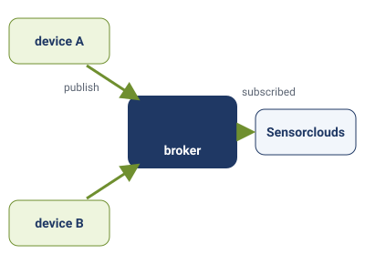
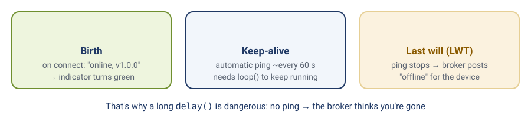

# Module 6 — MQTT & SSC Device Registration

**Goal:** Now that your device is online (Module 5), understand *how* it's talking — the MQTT messaging model underneath — so you can read the topics, register devices confidently, and diagnose connection problems on your own.

**Audience:** Completed [module-05-ssc-client](module-05-ssc-client.md).

**Estimated time:** 2 hours (mostly understanding + inspection — little new code)

**Deliverable:** You can explain the path a message takes from your device to the SSC dashboard, and you can fix the common "won't connect" problems without help.

> **Instructor note:** Module 5 was "make it work"; this module is "understand what just happened." No big new code here — the value is the mental model and the hands-on LWT/offline test in Section 6, which always gets an "oh, cool" from the room. Keep the dashboard event log projected.

---

## 1. What Is MQTT? (in plain terms)

**MQTT** is the small, efficient "texting" system that IoT devices use to talk to a server. Three roles:


*Publish and subscribe: everything goes through the broker.*

- **Broker** — the central post office. Everything goes through it. SSC runs the broker.
- **Client** — anything connected to the broker. Your board is a client; so is the dashboard.
- **Topic** — the *address* a message is sent to (a text path like `.../device/.../data`).
- **Publish** — send a message to a topic. **Subscribe** — ask the broker "send me everything posted to this topic."

> **The key idea:** nobody talks to anybody *directly*. Your board publishes to a topic; the dashboard subscribes to that topic; the broker connects the two. That's why your board doesn't need to know the dashboard's address — it only needs the broker's.

### Why MQTT and not a normal web request (HTTP)?

| | HTTP (like loading a webpage) | MQTT |
|--|-------------------------------|------|
| Connection | Opens a new one for every message | Stays connected all the time |
| Message size | Big headers | Tiny header (a couple of bytes) |
| Server → device | Device must keep asking "anything for me?" | Broker pushes instantly |
| Battery / data cost | High | Low |

For a sensor that sends small readings often and needs to receive commands anytime, MQTT is the right tool.

---

## 2. Topics — the Address Your Data Travels On

SSC builds four topics for each device from your **tenant**, **application**, and device **token**. You saw these printed in Serial in Module 5:

```
tenant/<tenantId>/app/<applicationId>/device/<token>/data     ← device → SSC (sensor readings)
tenant/<tenantId>/app/<applicationId>/device/<token>/status   ← device → SSC (online / offline)
tenant/<tenantId>/app/<applicationId>/device/<token>/cmd      ← SSC → device (commands)
tenant/<tenantId>/app/<applicationId>/device/<token>/ack      ← device → SSC (I did it)
```

The library builds these strings for you inside `begin()` and subscribes to the `cmd` one so the platform can reach the device. You never type them by hand.

> **Why the tenant/app/device path?** It keeps every device's messages in their own lane. Two companies (tenants) can use the same broker and never see each other's data, because their topics differ from the very first segment.

---

## 3. Three Features That Keep "Online/Offline" Honest

These are the parts students most often see but don't understand. Here's what each is *for*.


*Birth says "online", keep-alive keeps the connection, and the last will reports "offline" for a board that vanished.*

### Birth message — "I'm here"
When the device connects, the library publishes to the **status** topic:
```json
{"state":"online","firmwareVersion":"v1.0.0"}
```
*Why:* this is what turns the dashboard indicator green, and it reports which firmware is running (used later for OTA in Module 10).

### Last Will & Testament (LWT) — "if I vanish, tell them"
A device that loses power can't send a goodbye. So at connect time the device pre-registers a message with the broker: *"if I disappear, publish this offline notice for me."*
```json
{"state":"offline","reason":"lwt"}
```
*Why:* without it, a device that lost power would show a **stale "online"** forever. With it, the broker notices the silence (via keep-alive, below) and posts the offline notice automatically — no code runs on the dead device.

### Keep-alive — "still here" (automatic)
Between messages there can be gaps. What stops the **broker** from deciding the device vanished and firing its LWT? The **MQTT keep-alive**: a tiny automatic "ping" the library sends (about every 60 s) from inside `update()`. The template calls `update()` for you on every pass of `loop()` (inside `app.update()`).

*You write no code for this — there is no manual heartbeat to send.* It's also why a long `delay()` is dangerous: the ping stops, the broker gives up, and your LWT fires.

> **Keep-alive keeps the connection open; publishing keeps you "online" on the dashboard.** The Sensorclouds platform also tracks when it last *received data* from you, and marks a device offline after a few minutes of silence. That's why the template publishes every 10 s (Module 5). You need both.

---

## 4. A Word on QoS (Quality of Service)

MQTT lets each message pick how hard the broker tries to deliver it:

| Level | Meaning | Where SSC uses it |
|-------|---------|-------------------|
| **QoS 0** | Send once, no guarantee | Telemetry (a lost reading 30 s ago doesn't matter — a fresh one is coming) |
| **QoS 1** | Keep trying until confirmed | The **LWT** offline notice (you really don't want to miss that) |

You don't set these yourself — the library chose sensible defaults. Just know *why* telemetry is "fire and forget" but the offline notice is "make sure it arrives."

---

## 5. Registering a Device on SSC

```
Tenant  →  Application  →  Device
(your org)  (a group)      (one board)
```

1. **Applications → New Application** — name it (e.g. `IoT Learning Module`).
2. Inside it, **Devices → Add Device** — give it a readable name (e.g. `Aek-SSN32-01`).
3. Copy the values the platform generates — **Device ID, Token, Password** — plus note your **Tenant** and **Application** names. (The token/password may be shown only once.)
4. Type them into your device's **setup portal** (Module 5, Step 5d). They're saved in the board's memory, never in a file.
5. Restart the device from the portal and watch it appear online.

> **Why so many values?** Device ID names the connection, the token identifies the device *and* forms its topic path, the password proves it's allowed in, and tenant/app place it in the right lane. Get one wrong and you'll connect to the wrong lane — or be refused.

---

## 6. Lab — Inspect and Prove It (little new code)

Use the template you flashed in Module 5 (already online). This lab is about *seeing* the concepts work.

1. **Find the birth message.** In the dashboard event log, locate `{"state":"online",...}` and note its timestamp.
2. **The LWT test (the fun one).** Pull the USB cable **without** pressing reset. Wait up to ~90 seconds. Watch the device flip to **offline** in the dashboard — that's the broker publishing your LWT. Plug back in; watch it return online with a fresh birth message.
3. **Stay-online check.** Leave it connected 10 minutes. It stays online: telemetry every 10 s keeps the platform's "last seen" fresh, and the keep-alive holds the connection open in between.
4. **Break the credentials on purpose.** Open the setup portal again: press **EN** and let go, then straight away press and hold **BOOT** for about 5 seconds, until Serial shows `[Portal] Starting configuration portal`. (Don't hold BOOT *while* pressing EN or plugging in: that starts the chip's upload mode instead.) Change the **Device Token** to a wrong value, save, and restart. Read the Serial output to see how a rejected connection looks (`[SSC] Connection timeout` → `[SSC] Retry in …`, with the wait growing each time). Then open the portal again and put the correct token back.
5. **Explain the flow.** In your own words, write the steps from power-on to "online in dashboard": boot → `setup()` → WiFi connect → MQTT connect → LWT registered → birth published → subscribed to `cmd` → `update()` servicing the keep-alive every loop.

---

## 7. Diagnosing Connection Problems

| What you see | Likely cause | Fix |
|--------------|--------------|-----|
| `[WiFi] Connecting to …` repeats forever | Wrong SSID/password (case-sensitive) or a 5 GHz network | Re-enter Wi-Fi in the portal; use a 2.4 GHz network |
| WiFi OK, then `[SSC] Connection timeout` | Wrong broker host or port | Check the MQTT Host and port **8883** in the portal |
| Connects then drops repeatedly | Wrong token / password / tenant / app | Re-copy all IDs from the dashboard into the portal |
| Online, then offline after a few minutes | Nothing is being published | Check Serial for a `[SSC] Telemetry:` line every ~10 s |
| *(If you add your own code to the template)* offline after ~1–2 min | A `delay()` that blocks `loop()`, so the keep-alive stops | Keep `loop()` non-blocking (Module 4) |
| No birth message in log | `begin()` didn't finish, or dashboard opened before connect | Check Serial; refresh the dashboard |

> **The habit that prevents most of these:** copy the IDs carefully (they're long and easy to cut short), and keep `loop()` fast. This is exactly why Module 4 banned `delay()`.

---

## 8. Deliverable Checklist

- [ ] Device registered (ID, token, password, tenant, app entered in the setup portal)
- [ ] Device shows **online** after upload
- [ ] You found the birth message in the event log
- [ ] LWT test done — device went offline within ~90 s of unplugging, then back online
- [ ] You can explain, in one sentence each: topic, broker, birth message, LWT, and keep-alive
- [ ] You can describe the full power-on → online sequence

---

## 9. What's Next

In **[module-07-publish-telemetry](module-07-publish-telemetry.md)** you will:
- Wire the DS18B20, potentiometer and button to the template device
- See how the template packs them into the compact hex format SSC expects, on the `data` topic
- Watch real values move in the dashboard

