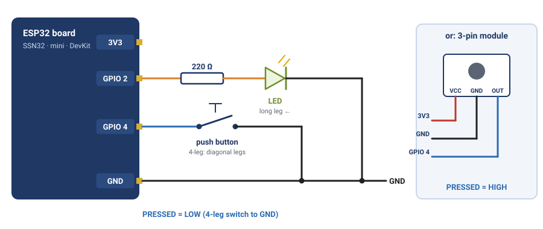
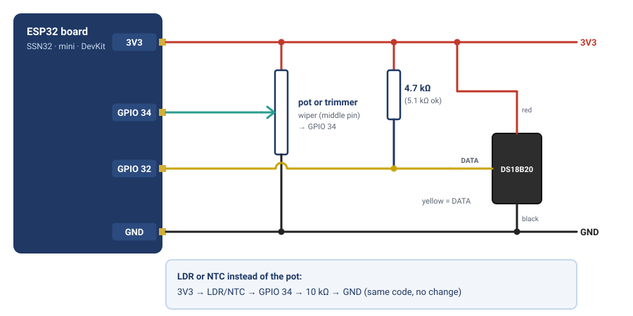
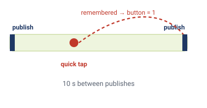
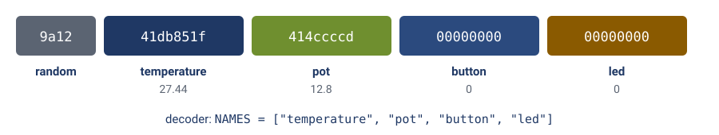

# Module 7 — Wire Your Parts, See Real Data

**Goal:** Wire the DS18B20, potentiometer and button to your online template device and watch **real** values arrive in SSC. Then read the template's `lib/sensor/sensor.cpp` so you understand exactly how each value gets from a pin to the cloud.

**Audience:** Completed [module-05-ssc-client](module-05-ssc-client.md) (device online via the template) and [module-06-mqtt-ssc-registration](module-06-mqtt-ssc-registration.md).

**Estimated time:** 1.5–2 hours.

**Deliverable:** Real temperature, analog and button values updating in the SSC dashboard every publish interval: holding the sensor makes the temperature rise, turning the knob (or covering the LDR) moves `pot`, pressing the button shows `button = 1`.

---

## 1. What the template already does

The template's `lib/sensor/sensor.cpp` already reads **every part used in this course** and publishes them all, every interval (10 s by default):

| Role | Pin | Name in the payload | Value | Parts that fit |
|------|-----|---------------------|-------|----------------|
| Digital sensor | GPIO 32 | `temperature` | °C (empty if no sensor is found) | DS18B20 |
| Varying input | GPIO 34 | `pot` | 0–100 % | Potentiometer, 3296 trimmer, LDR + 10 kΩ, NTC + 10 kΩ |
| On/off input | GPIO 4 | `button` | `1` pressed, `0` not pressed | 4-leg switch, 3-pin button module, 4N35 optocoupler |
| On/off output | GPIO 2 (on-board LED) | `led` | `1` on, `0` off (you switch it from the cloud in Module 9) | LED + 220 Ω, active buzzer through a transistor |

These are the **same pins and roles you used in Modules 2–4**, so your breadboard wiring carries straight over, whichever parts you chose. The template reads the *role*, so it works with any part in the last column and **no code change**. (The names in the payload stay the same: an LDR on GPIO 34 is still sent as `pot`.) Wiring for every option: [swap-your-parts](swap-your-parts.md).

> **Why it publishes even with nothing wired:** a device that stops publishing is marked offline. So the template always sends all four values. A missing DS18B20 is sent as "no value" (not a made-up number), so you can never mistake a fake reading for a real one.

---

## 2. Wire everything

Unplug the USB cable while you wire. It's the same wiring as Modules 2 and 3:


*GPIO 2 and GPIO 4, as in Module 2.*


*GPIO 34 and GPIO 32, as in Module 3.*

| Part | Part pin | SSN32 pin |
|------|----------|-----------|
| **DS18B20** | VCC (red) | 3.3 V |
| | GND (black) | GND |
| | DATA (yellow) | GPIO 32, **plus a 4.7 kΩ (or 5.1 kΩ) resistor from DATA to 3.3 V** |
| **Potentiometer** or **3296 trimmer** | one outer leg | 3.3 V |
| | middle leg (wiper) | GPIO 34 |
| | other outer leg | GND |
| *or* **LDR / NTC** *(instead of the pot)* | one leg / other leg | 3.3 V / GPIO 34, plus **10 kΩ from GPIO 34 to GND** |
| **4-leg switch** | one leg / the diagonally opposite leg | GPIO 4 / GND |
| *or* **3-pin button module** | VCC / GND / OUT | 3.3 V / GND / GPIO 4 |
| **LED** *(optional)* | anode (long leg) | GPIO 2 through the 220 Ω resistor |
| | cathode (short leg) | GND |
| *or* **active buzzer** *(optional)* | through the 2N2222A transistor | GPIO 2 (circuit in Module 2, "Swap the output — make it beep") |

Notes:
- The DS18B20's **pull-up resistor is required**: without it the sensor isn't found and `temperature` stays empty.
- **Any input part works without changing any code.** At power-up the template checks which way GPIO 4 rests and treats the opposite as "pressed". So don't hold the button while the board starts.
- The **LED is already there**: GPIO 2 drives the SSN32's on-board LED. An external LED on GPIO 2 simply lights together with it.

---

## 3. Watch the real values arrive

▶ Plug the board back in, open **🔌 Serial Monitor** and press **EN**. 👁 You should see:

```
[Sensor] DS18B20 found: 1
[Sensor] Button on GPIO 4 reads LOW when pressed
...
[Sensor] temperature=27.44 pot=12.8% button=0 led=0
[SSC] Telemetry: 9a1241db851f414ccccd0000000000000000
```

*(`reads HIGH when pressed` if you used the 3-pin module.)*

No re-upload needed: the template already has all the code. It just finds the parts now.

▶ Open SSC → your device → **Live Data**, and try each part. Each change shows at the **next publish** (within 10 s):

| Do this | You should see |
|---------|----------------|
| Hold the DS18B20 in your hand for 20 s | `temperature` rises a degree or more |
| Turn the potentiometer fully one way, then the other (a multi-turn trimmer takes ~25 turns each way) | `pot` goes to about 0, then about 100 |
| *(LDR instead)* Cover it, then shine a phone torch on it | `pot` drops low, then climbs high |
| Press the button once, quickly | `button` shows `1` for one publish, then `0` |
| Hold the button down | `button` stays `1` |


*A tap between two publishes is remembered and sent as button = 1.*

> **Why does a quick tap still show up?** The button is only *reported* every 10 s, but the template *watches* it all the time: a press at any moment is remembered until the next publish. Otherwise you'd have to hold the button for up to 10 seconds to be sure it was seen.

---

## 4. Read the code: how a pin becomes a cloud value

Open `lib/sensor/sensor.cpp`. You don't need to change it, but you should be able to explain it. Everything happens in two functions:

| Function | When it runs | What it does |
|----------|-------------|--------------|
| `sensorBegin()` | once, at startup | sets up the DS18B20, the button pin and the LED pin |
| `doRead()` | every publish interval | reads all four parts and adds each value with `r.add("name", value)` |

The heart of `doRead()`:

```cpp
// 1. Temperature: read the result of the conversion started last time
float t = sensors.getTempCByIndex(0);
if (t == DEVICE_DISCONNECTED_C) {
    t = NAN;                          // "no value": never a fake number
}
sensors.requestTemperatures();        // start the next conversion
r.add("temperature", t);

// 2. Potentiometer as 0–100 %
r.add("pot", readPotPercent());

// 3. Button: pressed now, or pressed since the last publish
r.add("button", pressed ? 1.0f : 0.0f);

// 4. LED state
r.add("led", ledIsOn() ? 1.0f : 0.0f);
```

Three things to notice, all from earlier modules:

- **"Ask now, read later"** (Module 4). A DS18B20 reading takes ~750 ms. Instead of waiting, the template *starts* a conversion after each publish and *reads* the finished result at the next one. The loop never blocks, so Wi-Fi and MQTT keep running.
- **Averaging** (Module 3). `readPotPercent()` takes 16 ADC samples and averages them, so the value doesn't jitter.
- **The order of `r.add()` calls matters.** The values are sent in exactly this order, and the platform's decoder reads them back in the same order (Section 5).

You never call `publishTelemetry` yourself. `SSCApp` calls `sensorRead()` on its timer and publishes whatever `doRead()` returns. That timed publish is what keeps the device online.

---

## 5. The payload and the decoder


*The 18-byte payload: a random nonce, then one 4-byte number per value, in r.add() order.*

The template sends a compact hex string: a **4-character random nonce**, then **8 hex characters (one IEEE-754 float) per value**, in the `r.add()` order:

```
9a12  41db851f  414ccccd  00000000  00000000
nonce temp=27.44 pot=12.8  button=0  led=0
```

SSC turns this back into named values with a **decoder**: a short script you paste into the device in Sensorclouds. The complete, tested script is in the course repo at **`sensorclouds-template/docs/platform/decoder.md`**, with test payloads you can try in the decoder's test box. Your instructor may have added it for you already.

> **Why not just send `{"temperature": 27.44}` as text?** Over Wi-Fi it would work fine. But the same 18 bytes can also travel over low-power radio networks like LoRaWAN, which only carry a few dozen bytes per message and can't fit field names. Every value is always exactly 4 bytes, so the size never changes. Sending compact numbers and decoding them on the server is the normal industrial pattern, and this course teaches it from the start.

---

## 6. Go further: add a value of your own

Say you add a humidity sensor. Two steps, and the **order must match**:

1. In `doRead()`, add your value **after** the existing four:
   ```cpp
   r.add("humidity", h);
   ```
2. In the decoder, add `"humidity"` at the **end** of the `NAMES` list:
   ```js
   const NAMES = ["temperature", "pot", "button", "led", "humidity"];
   ```

If the two lists don't match, every value after the mismatch lands in the wrong field. Up to 16 values fit in one publish.

---

## 7. Troubleshooting

| Symptom | Cause | Fix |
|---------|-------|-----|
| `[Sensor] DS18B20 not found`, `temperature` empty | Missing pull-up, wrong pin or loose wire | Check the resistor from DATA to 3.3 V and that DATA is on GPIO 32 |
| `temperature` reads exactly `85` | 85 °C is the sensor's power-on value: its measurement never finished | Usually the red VCC wire isn't on 3.3 V. Check it |
| `pot` stuck near 0 % or 100 % with an LDR or NTC | The 10 kΩ from GPIO 34 to GND is missing | Add it: the LDR or NTC is only half of the divider |
| `pot` jumps around randomly | Nothing (or a loose wire) on GPIO 34 | Check the middle leg goes to GPIO 34 and the outer legs to 3.3 V and GND |
| `pot` stays at 100 % (or 0 %) whatever you do | A multi-turn trimmer sitting at one end, a GND (or 3.3 V) wire not connected, or a broken trimmer | A trimmer (blue box, brass screw) needs about 25 turns end to end and never stops: keep turning the other way. Then touch the GPIO 34 wire to GND: if Serial shows about 0 %, the board is fine and the pot or its wiring is the problem. Meter the trimmer (Module 3 box) and swap it if dead |
| `temperature` empty or wrong although the wiring looks right | A bad jumper wire or a faulty board | Swap the jumper wires one by one, then try another SSN32. Breadboard jumpers fail more often than you'd expect |
| `pot` only goes from 100 down to 0 the "wrong" way | Outer legs swapped | Swap the 3.3 V and GND wires on the potentiometer (or leave it, it's still correct) |
| `button` is always `1` | The button was held down while the board started | Release it and press **EN** |
| `button` never changes | A plain button wired to 3.3 V, or a 3-pin module without VCC | A plain button goes between GPIO 4 and **GND**; the 3-pin module needs VCC on 3.3 V |
| Serial shows `[SSC] Telemetry:` lines but SSC shows no values | The device has no decoder (or an old one) | Paste the decoder from `docs/platform/decoder.md` (ask your instructor) |
| Decoder returns `Expected 18 bytes` | Firmware and decoder `NAMES` don't match | Make both lists the same length and order (Section 6) |

---

## 8. Deliverable Checklist

- [ ] DS18B20, potentiometer and button wired; Serial shows `DS18B20 found: 1`
- [ ] Serial shows a `[SSC] Telemetry:` line every publish interval
- [ ] SSC Live Data: temperature rises when you hold the sensor, `pot` follows the knob, `button` shows `1` after a press
- [ ] You can explain "ask now, read later" in the temperature code, and why the `r.add()` order must match the decoder

---

## 9. What's Next

**[module-08-ssc-dashboard](module-08-ssc-dashboard.md)** — build charts and gauges from your values (platform side). Then **[module-09-receive-commands](module-09-receive-commands.md)** — switch the LED and change the publish interval from the cloud.

