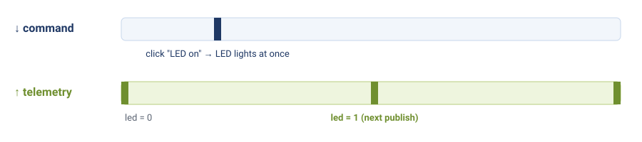
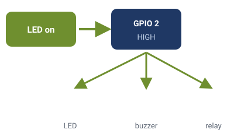

# Module 9 — Control the Device from the Cloud

**Goal:** Send a command *down* from the SSC dashboard and have the device change its behaviour live (no reboot), then confirm it. The template already handles this — you'll drive it from the platform and understand the flow.

**Audience:** Completed [module-08-ssc-dashboard](module-08-ssc-dashboard.md). Your device is online and publishing.

**Estimated time:** 1–1.5 hours.

**Deliverable:** Switching the LED and changing the publish interval from the SSC dashboard both work live; each command's ACK appears in the event log; the device never reboots, and it remembers the new interval.

---

## 1. The full two-way loop

Until now, data only went **up**. Commands complete the picture:

```
Device ──[ telemetry ]──> SSC          (Module 7)
Device <──[ command  ]── SSC dashboard (this module — an operator clicks a button)
Device ──[   ACK     ]──> SSC          (device confirms it did the thing)
```

This is what makes IoT *controllable*: retune a device without touching the hardware.

---

## 2. The template already receives commands

When the template connects, it subscribes to your device's **command** topic. When the platform sends a command there, `SSCApp` routes it to a handler, applies it, saves it to flash (so it survives a reboot), and replies with an **ACK**. **You write no firmware for this** — it's built in.

The template ships two ready commands:

### `config:set_led` — switch the LED on or off

| Field | Value |
|-------|-------|
| Command | `config:set_led` |
| Parameters | `{ "state": 1 }` (on) or `{ "state": 0 }` (off) |

- Drives GPIO 2: the SSN32's on-board LED, plus your external LED if you wired one.
- Any other value (e.g. `{ "state": 5 }`) is rejected with a `failed` ACK.
- The new state appears as `led` in the next publish, so the dashboard can show it.
- It is **not** saved: after a restart the LED starts off. (A live control, unlike a setting.)

### `config:set_interval` — change how often the device publishes

| Field | Value |
|-------|-------|
| Command | `config:set_interval` |
| Parameters | `{ "publish_interval_ms": 30000 }` |

- **Bounds:** 1000 ms – 3600000 ms (1 s to 1 hour). Out-of-range values are rejected with a `failed` ACK.
- The new interval takes effect on the next loop tick — **no reboot** — and is saved to NVS, so it persists.

---

## 3. Lab A — switch the LED from the cloud

1. ▶ With the device online (from Module 7), open SSC → your device → **Send Command** (or use the LED buttons you built in Module 8).
2. ▶ Send **`config:set_led`** with **`{ "state": 1 }`**.
3. 👁 The LED on the board lights **immediately**. Serial shows `[CfgCmd] LED -> on`, and the event log shows the ACK:
   ```json
   { "commandId": "...", "command": "config:set_led", "status": "ok" }
   ```
4. 👁 At the next publish, the `led` channel shows `1`.
5. ▶ Send `{ "state": 5 }`. 👁 The device replies `status: "failed"` with `State must be 0 or 1`, and the LED doesn't change.
6. ▶ Send `{ "state": 0 }` to switch it off.


*Commands arrive at once; the new state shows up in the next 10-second publish.*

> **Why did the LED react instantly but the `led` value only later?** Commands are pushed to the device the moment you send them. Telemetry goes up on the device's own timer (every 10 s). Two separate directions, two separate timings.

### Swap the output: a remote alarm


*One command, any on/off output part on GPIO 2.*

`config:set_led` doesn't know there is an LED on GPIO 2. It just sets the pin HIGH or LOW. Put the **active buzzer** (through the transistor, as in Module 2's "Swap the output — make it beep") on GPIO 2 instead, and the same command becomes an **alarm you switch on from the cloud**: `{ "state": 1 }` beeps, `{ "state": 0 }` stops. Same firmware, same dashboard buttons, a different part. Keep the test short, it's loud. (The on-board LED still lights with it, so you can see the pin's state even when the buzzer is off.)

## 4. Lab B — change the interval from the cloud

1. ▶ Send command **`config:set_interval`** with parameters **`{ "publish_interval_ms": 30000 }`**.
2. 👁 On Serial you'll see the device accept it; the `[SSC] Telemetry:` lines now appear every **30 s** instead of every 10 s.
3. 👁 In the event log, an ACK appears:
   ```json
   { "commandId": "...", "command": "config:set_interval", "status": "ok" }
   ```
4. ▶ Send an out-of-range value, e.g. `{ "publish_interval_ms": 50 }`. 👁 The device replies `status: "failed"` and keeps its previous interval.
5. ▶ Restart the board (press **EN**). 👁 It comes back publishing at **30 s**: the interval was saved. (The LED is off again: only settings are saved.)
6. ▶ Set it back to `{ "publish_interval_ms": 10000 }`.

---

## 5. How the ACK lifecycle looks on the platform

Every command moves through: **PENDING → SENT → ACKNOWLEDGED** (or **FAILED / TIMEOUT**). You'll see this in the command history — it's how an operator knows the device actually applied the change, not just that the message was sent.

---

## 6. Optional — adding your own command

The command handling lives in the template's `lib/config_cmd_handler/`. A new command is a new `command:` name plus a small handler that reads its parameters and applies them (the same pattern as `handleSetLed()`, the shortest one to copy). This is a "go further" exercise — the two built-in commands are all Module 9 requires.

> **Under the hood:** if you want to see how a command is parsed from raw MQTT bytes by hand (`setCommandCallback`, `deserializeJson`, a self-built ACK), that's in [appendix-under-the-hood-ssc-client](appendix-under-the-hood-ssc-client.md) and the low-level code in [modules-5-10-step-by-step](modules-5-10-step-by-step.md).

---

## 7. Deliverable Checklist

- [ ] Switched the LED on and off with `config:set_led`; `led` showed the new state at the next publish
- [ ] Sent `config:set_interval` from SSC; the device's publish rate changed live
- [ ] The ACK (`status: ok`) appeared in the event log
- [ ] Invalid values (`state: 5`, interval `50`) were rejected with `failed`
- [ ] The new interval survived a reboot (saved to flash)
- [ ] The device never rebooted to apply the change
- [ ] You can describe the PENDING → SENT → ACKNOWLEDGED lifecycle

---

## 8. What's Next

**[module-10-ota](module-10-ota.md)** (bonus) — update the device's firmware over the air, also built into the template.

