# Setup Guide

This guide takes a normal Windows or Mac computer from nothing installed to a board that prints its first message. You don't need to know anything about electronics or code yet. Follow the steps in order. Each one ends with a **Check**: don't move on until it passes, because every step needs the one before it.

| | |
|---|---|
| **Time** | About an hour, most of it waiting for downloads |
| **Part A** (Steps 1–4) | Your computer only, no board needed. Please do this part **at home before day 1**: it downloads about 1 GB, and the venue Wi-Fi is slow when everyone downloads at once. |
| **Part B** (Steps 5–6) | Your computer, your board and a USB cable. At home if you already have your board, otherwise in the first hour of day 1. |
| **You finish with** | `SSN32 ready.` printed by your own board |

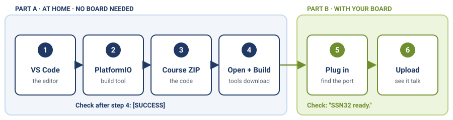
*The six steps. Part A needs only your computer; Part B needs the board and a USB cable.*

## Before you start

- [ ] A **Windows 10/11** or **macOS** computer that you're allowed to install programs on (admin rights)
- [ ] About **3 GB of free disk space**
- [ ] A good internet connection for the first hour
- [ ] For Part B: your **board** and a **USB data cable** that fits it (Micro-USB or USB-C, see "Your board")

> **Watch out: the cable.** Many cheap cables only *charge*: the board lights up, but the computer never sees it. A cable that came with a phone usually carries data. If your laptop has only USB-C ports, you need a cable or an adapter that ends in USB-C.

| Micro-USB plug | USB-C plug |
|:---:|:---:|
| 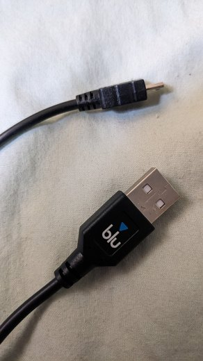 | 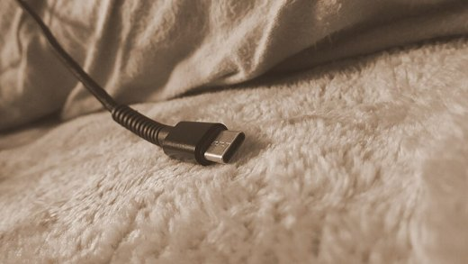 |
| SSN32 and ESP32 DevKit | ESP32 mini board |

## Words you'll meet

You don't need to memorise these. Come back here when a word is new.

| Word | What it means |
|------|---------------|
| **ESP32** | The chip at the heart of every board in this course: a small computer with Wi-Fi |
| **Firmware** | The program that runs on the board. You write it on your computer, then copy it to the board |
| **VS Code** | The program you write code in, like a word processor for code |
| **PlatformIO** | An add-on for VS Code that turns your code into firmware and copies it to the board |
| **Build** | Turn your code into firmware. It also checks the code for mistakes |
| **Upload** | Copy the firmware onto the board through the USB cable |
| **Driver** | A small program that lets your computer talk to the board's USB chip |
| **Port** | The name your computer gives the board when it's plugged in (`COM3` on Windows, `/dev/cu.usbserial…` on Mac) |
| **Serial Monitor** | A window that shows the messages the board sends back to your computer |
| **ZIP** | One file that holds a whole folder. You unpack ("extract") it before using it |

---

## Part A — Your computer (no board needed)

### Step 1 — Install VS Code

**Windows**
1. Go to `code.visualstudio.com` and click **Download for Windows**.
2. Run the downloaded file (`VSCodeUserSetup-….exe`). Accept the agreement, keep the default options, and click **Install**.
3. Click **Finish**.

**Mac**
1. Go to `code.visualstudio.com` and click **Download for macOS**.
2. Open your **Downloads** folder: the download becomes **Visual Studio Code.app**.
3. Drag **Visual Studio Code.app** into your **Applications** folder.
4. Open it from Applications. If macOS warns that it was downloaded from the Internet, click **Open**.

> **Check:** VS Code opens and shows a *Welcome* page.

### Step 2 — Install PlatformIO

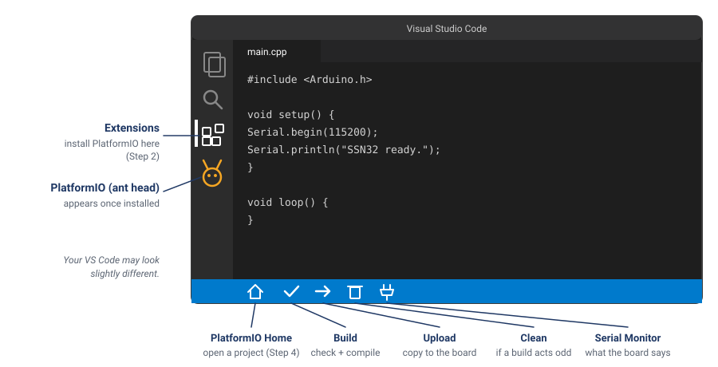
*Where things are in VS Code. You install PlatformIO from the Extensions icon; its buttons then appear in the blue bar at the bottom.*

**First, one check (only if it applies to you)**

*Windows: does your user name have non-English letters?* Open **File Explorer** and go to `C:\Users`. If *your* folder name has Thai, Lao or other non-English letters, PlatformIO can't install there. Fix it first:

1. Create a folder `C:\.platformio`.
2. Press **Start**, type `environment`, and open **Edit environment variables for your account**.
3. Under *User variables*, click **New…**. Name: `PLATFORMIO_CORE_DIR`. Value: `C:\.platformio`. Click **OK** twice.
4. Close VS Code and open it again.

(English letters only, or just spaces? Skip this.)

*Mac: is Python installed?* PlatformIO needs it. Open **Terminal** (press `Cmd + Space`, type `Terminal`, press Enter), type `python3 --version` and press Enter.

- It prints `Python 3.x.x`: you're ready.
- A window asks to install **command line developer tools**: click **Install**, wait 5–15 minutes, then type the command again.

**Install the extension**

1. In VS Code, click the **Extensions** icon on the left bar (four small squares), or press `Ctrl+Shift+X` (Windows) / `Cmd+Shift+X` (Mac).
2. Type **PlatformIO IDE** in the search box. Click **Install** on the one by **PlatformIO**.
3. Wait. The bottom-right corner says *Installing PlatformIO Core…* for 2–10 minutes. Don't close VS Code.
4. When it asks you to **Reload** or restart, click it.

> **Check:** an **ant-head icon** appears on the left bar, and a small **house icon** in the blue bar at the bottom.

### Step 3 — Download the course code

You don't need Git or a GitHub account. You download the whole course once, as a ZIP.

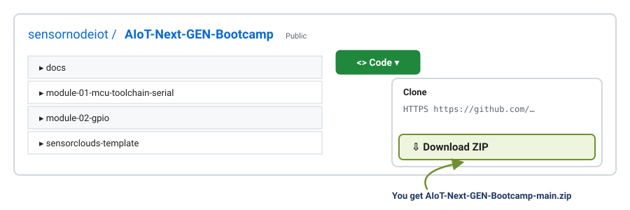
*On the course page, the green Code button hides the Download ZIP option.*

1. In your web browser, open `github.com/sensornodeiot/AIoT-Next-GEN-Bootcamp`.
2. Click the green **`<> Code`** button, then **Download ZIP**.

**Windows: extract it to `C:\IoT`**
1. Open **Downloads**, **right-click** the ZIP, and choose **Extract All…**.
2. Change the place to `C:\IoT` and click **Extract**.
3. Rename the new folder from `AIoT-Next-GEN-Bootcamp-main` to **`AIoT-Next-GEN-Bootcamp`**.

> **Watch out:** don't just double-click the ZIP and work inside it: that's only a preview, and nothing will build. And don't use Desktop or Documents if they sync to OneDrive. Why `C:\IoT`? Building creates very long file paths, and Windows has a limit on path length. A short folder at the top of the drive avoids strange errors.

**Mac: extract it to an `IoT` folder in your home folder**
1. Open **Downloads** and **double-click** the ZIP. A folder `AIoT-Next-GEN-Bootcamp-main` appears.
2. In Finder press `Cmd + Shift + H` (your home folder) and create a new folder called **`IoT`**.
3. Drag the folder into `IoT` and rename it **`AIoT-Next-GEN-Bootcamp`**.

> **Watch out:** avoid Desktop or Documents if they sync to iCloud Drive.

**What's inside**

```
AIoT-Next-GEN-Bootcamp/
├── docs/                             ← all the written lessons (this guide too)
├── module-01-mcu-toolchain-serial/   ← Modules 1–4: one small project each
├── module-02-gpio/
├── module-03-sensors/
├── module-04-firmware-patterns/
├── sensorclouds-template/            ← Modules 5–10: one shared, complete project
└── appendix-low-level/               ← optional extras, for after the course
```

> **Check:** you have the folder `C:\IoT\AIoT-Next-GEN-Bootcamp` (Windows) or `IoT/AIoT-Next-GEN-Bootcamp` in your home folder (Mac), and it contains the folders above.

### Step 4 — Open Module 1 and build it

**The one rule:** always open **one module folder**, the one with the file `platformio.ini` directly inside it. Never open the whole `AIoT-Next-GEN-Bootcamp` folder: PlatformIO won't find a project, and the build buttons won't appear.

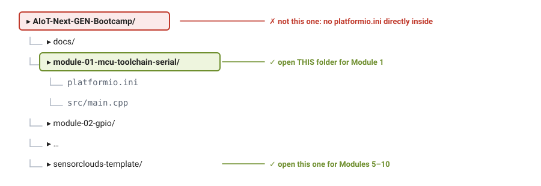
*Open the module folder itself, not the course folder around it.*

1. In VS Code, click the **house icon** in the blue bar at the bottom (PlatformIO Home).
2. Click **Open Project**.
3. Go to `AIoT-Next-GEN-Bootcamp` → **`module-01-mcu-toolchain-serial`**, and click the blue **Open "module-01-mcu-toolchain-serial"** button.
4. If VS Code asks *"Do you trust the authors…?"*, click **Yes, I trust the authors**.
5. Click **✓ Build** in the blue bar. The first build downloads the ESP32 tools (about 1 GB), so it takes 5–20 minutes. A panel opens at the bottom and shows the progress.

*(This also works: **File → Open Folder…** and pick the same module folder.)*

> **Check:** the panel at the bottom ends with a green **`[SUCCESS]`**. That's Part A done: your computer is ready, and the big download is behind you.

---

## Part B — Your board

### Your board

The course uses three kinds of board. Yours is one of them:

| SSN32 | ESP32 mini board | ESP32 DevKit (ESP-32UE) |
|:---:|:---:|:---:|
|  | 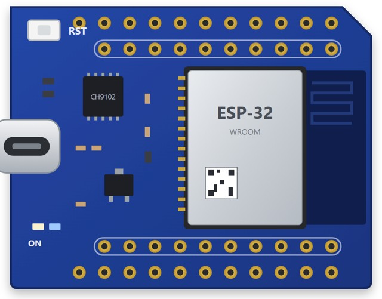 | 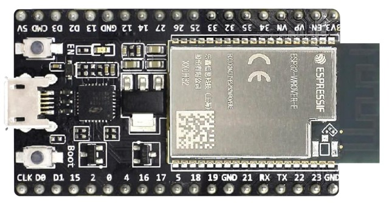 |
| photo | drawing | Espressif's DevKitC: yours has an ESP-32UE module with a small gold antenna connector |

All three are **ESP32 boards with the same GPIO numbers**. Every pin number in the course (GPIO 2, 4, 32, 34) and every line of code works on all three. Only the *positions* of the pins on the board differ, so always find a pin by the label printed next to it: `IO4`, `G4`, `D4` and `4` all mean GPIO 4.

| | SSN32 | ESP32 mini board | ESP32 DevKit (ESP-32UE) |
|---|---|---|---|
| USB plug | Micro-USB | **USB-C** | Micro-USB |
| Restart button | EN | **RST** | EN |
| BOOT button | yes | **none**: touch a jumper from `IO0` to `GND` instead | yes |
| Antenna | built in | built in | **external, in the box**: screw it onto the small gold connector before you use Wi-Fi (Module 5) |
| LED on GPIO 2 | yes | yes | yes |
| USB chip (needs a driver) | CP2102 or CH340 | **CH9102** | CP2102 or CH340 |

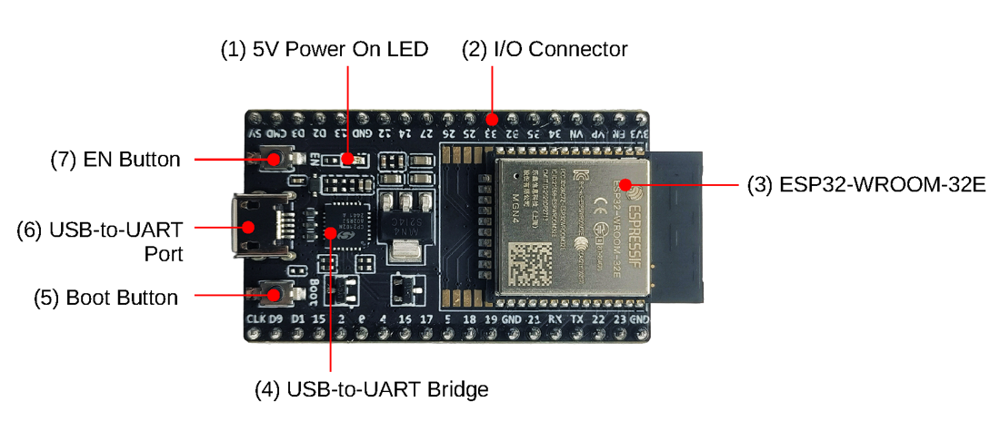
*The parts of an ESP32 DevKit (Espressif's DevKitC shown): EN and Boot buttons, the USB socket and its USB-to-UART chip, the power LED and the pin rows. The SSN32 and the mini board have the same parts in other places.*

The name of the USB chip is printed on the small chip next to the USB socket. When a lesson says "press **EN**", press **RST** on the mini board. When it says "hold **BOOT**", mini-board users hold a jumper wire from `IO0` to `GND` instead.

### Step 5 — Plug in and find the board's port

The board's USB chip needs a driver. Many computers already have one, so check first.

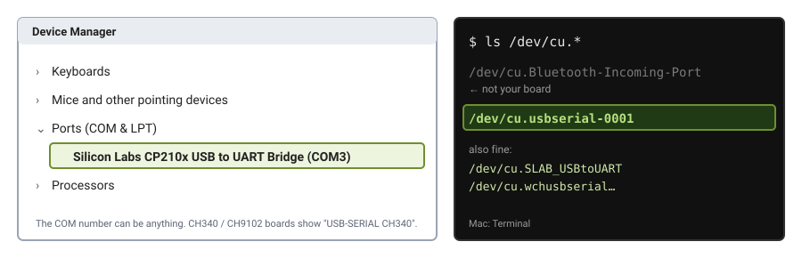
*Left: Windows Device Manager. Right: Mac Terminal. Either way you're looking for one new line: your board.*

**Windows**
1. Plug the board in with your data cable. A small light on the board turns on.
2. Right-click the **Start** button and choose **Device Manager**.
3. Open **Ports (COM & LPT)**. Look for a line like `Silicon Labs CP210x USB to UART Bridge (COM3)` or `USB-SERIAL CH340 (COM4)`. The number can be anything: that's your board.
4. Not there? (No *Ports* section, or the board appears under *Other devices* with a yellow warning sign.) Install the driver for your USB chip:
    - **CP2102:** search the web for "CP210x VCP drivers" on the **Silicon Labs** website, download the Windows driver, unzip it, and run `…x64.exe`.
    - **CH340:** search for "CH341SER" on the **WCH** website, download `CH341SER.EXE`, run it and click **INSTALL**.
    - **CH9102:** search for "CH343SER" on the **WCH** website and install it the same way.

    Unplug the board, plug it back in, and look again.

**Mac**
1. Plug the board in with your data cable. A small light on the board turns on.
2. In **Terminal**, type `ls /dev/cu.*` and press Enter.
3. Look for a line like `/dev/cu.usbserial-0001`, `/dev/cu.SLAB_USBtoUART` or `/dev/cu.wchusbserial…`. That's your board. (`Bluetooth-Incoming-Port` is not.)
4. Only Bluetooth lines? Install the driver:
    - **CP2102:** search for "CP210x VCP drivers" on the **Silicon Labs** website and install the macOS driver.
    - **CH340 / CH9102:** new macOS versions already have it. If it's still missing, search for "CH34x macOS driver" on the **WCH** website.

    Then open **System Settings → Privacy & Security**. If it says software was blocked, click **Allow** and restart the Mac.

> **Check:** you can see your board's port. Windows: a `COM` line under *Ports*. Mac: a `/dev/cu.usbserial…`, `/dev/cu.SLAB_USBtoUART` or `/dev/cu.wchusbserial…` line.
>
> Still nothing after installing the driver? It's almost always the **cable**. Try another cable, and plug straight into the computer, not into a USB hub.

### Step 6 — Your first upload

With `module-01-mcu-toolchain-serial` open and the board plugged in, use the buttons in the blue bar at the bottom of VS Code:

| Button | Name | What it does |
|:------:|------|--------------|
| ✓ | **Build** | Turns your code into firmware (and checks it) |
| → | **Upload** | Builds, then copies the firmware onto the board |
| plug | **Serial Monitor** | Shows what the board sends back |
| bin | **Clean** | Deletes old build files, if a build acts strangely |

1. Click **→ Upload**. You'll see `Connecting....`, then a percentage counting up, then **`[SUCCESS]`**.
2. Click **Serial Monitor** (the plug icon).
3. Press **EN** on the board (**RST** on the mini board) to restart it.

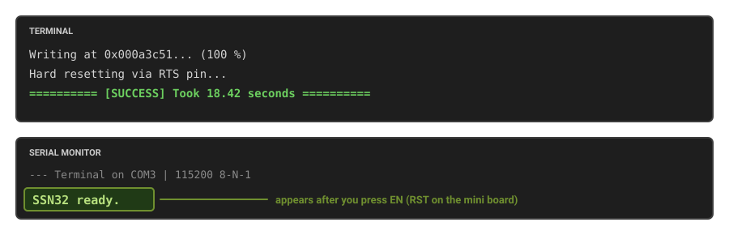
*Upload, then open the Serial Monitor and restart the board: the first message appears.*

> **Check:** the Serial Monitor shows `SSN32 ready.` (whichever board you have: it's the text the Module 1 program prints).

That's the whole setup: your computer, cable, driver and PlatformIO all work. Take a screenshot of it: your instructor may ask for it on the first day.

PlatformIO finds the board's port by itself, and every project in the course already has the right Serial speed (115200), so there's nothing to choose.

---

## Check your kit

Every lab is built from these parts on one breadboard.

**Before you start the labs:** each lab names one part for each job, but **you are never stuck with that part.** The board doesn't know *which* part is connected; a pin only sees a voltage. So any part that does the same **job** works on the same pin, usually with no code change. [swap-your-parts](swap-your-parts.md) shows the wiring for every option.

| Job | Pin | Basic kit | Also fits (extra pack) | From |
|-----|-----|-----------|------------------------|------|
| **On/off output** | GPIO 2 |  **LED** + 220 Ω | active **buzzer** through the 2N2222A transistor | Module 2 |
| **On/off input** | GPIO 4 | 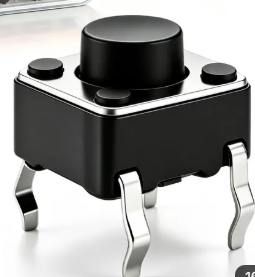 **4-leg switch** *or*  **3-pin module** | 4N35 optocoupler | Module 2 |
| **Varying input** | GPIO 34 |  **potentiometer** (knob or 3296 trimmer) | LDR + 10 kΩ, NTC thermistor + 10 kΩ | Module 3 |
| **Digital sensor** (1-Wire) | GPIO 32 |  **DS18B20** + 4.7 kΩ, with the 3-pin screw terminal | nothing else: the NTC senses temperature too, but it's analog, so it goes on GPIO 34 | Module 3 |

**Also in the kit**

| Photo | Part | Qty |
|-------|------|-----|
|  | **Breadboard** (400 holes) | 1 |
|    | **Resistors**: 220 Ω (LED), 4.7 kΩ (DS18B20), 10 kΩ (LDR / thermistor) | 1 each |
|  | **Jumper wires, male–female, short** | 6 |
|  | **Jumper wires, male–female, long** | 3 |
|  | **Jumper wires, male–male, short** | 13 |
|  | **3-pin screw terminal** for the DS18B20's wires | 1 |

**The extra component pack** (if your class has it). None of these is required; each one fits a job above, or helps another part do its job:

| | | | | | | |
|:---:|:---:|:---:|:---:|:---:|:---:|:---:|
| 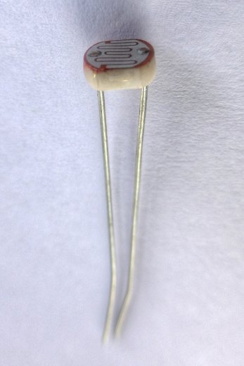 | 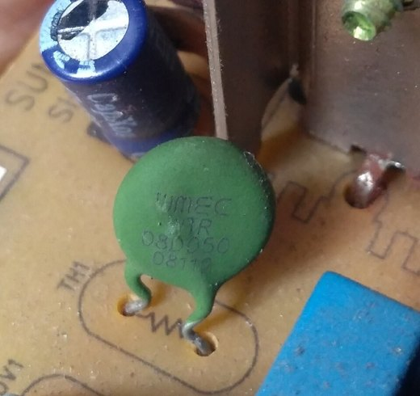 | 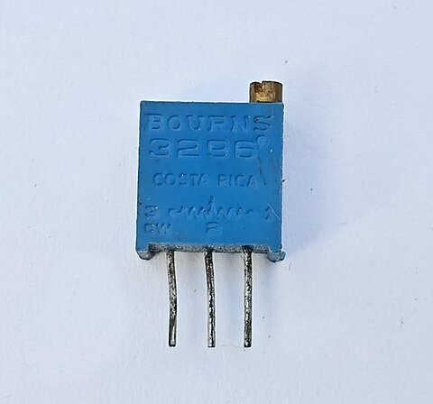 | 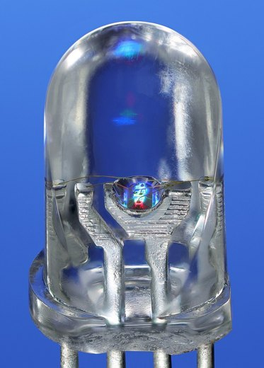 | 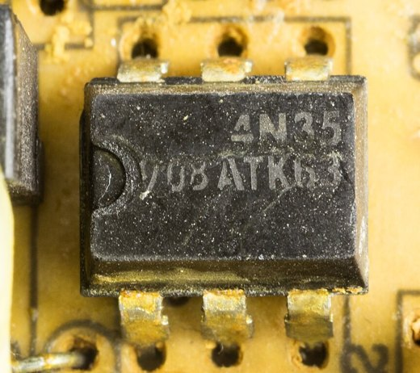 | 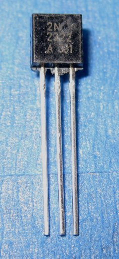 | 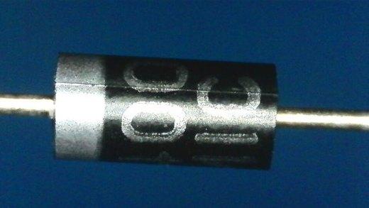 |
| **LDR** light sensor | **NTC** thermistor | **3296** trimmer | **RGB LED** | **4N35** optocoupler | **2N2222A** transistor | **1N4007** diode |
| varying input | varying input | varying input | on/off output (common-cathode type) | on/off input | switches the buzzer | protects the transistor |

- Some kits have a **5.1 kΩ** resistor (bands green-brown-…) instead of 4.7 kΩ (yellow-violet-…). It works exactly the same for the DS18B20.

---

## Which folder for which module?

| Module | Open this folder | What you do |
|--------|------------------|-------------|
| 0 | *(none)* | this setup guide |
| 1 | `module-01-mcu-toolchain-serial` | fill in `src/main.cpp` |
| 2 | `module-02-gpio` | fill in `src/main.cpp` |
| 3 | `module-03-sensors` | fill in `src/main.cpp` |
| 4 | `module-04-firmware-patterns` | split the code into files |
| **5–10** | **`sensorclouds-template`** | upload it, set it up in your browser, wire your parts, send commands |
| 8 | *(none)* | dashboard work on the Sensorclouds website |
| Appendix | `appendix-low-level/module-0X-…` | optional, after the course |

There are two kinds of project:

- **Modules 1–4:** each module is its **own** small project. You write the code.
- **Modules 5–10:** **one shared project**, `sensorclouds-template`. It's already complete: you upload it, set it up in a web browser, and wire your parts to it. It reads all four jobs above and sends them to Sensorclouds every 10 seconds, with no code to write. The first time, the board creates its own Wi-Fi network called `SSN32-Config`; [module-05-ssc-client](module-05-ssc-client.md) walks you through it.

To switch modules: house icon → **Open Project** → the next folder (or **File → Open Recent**).

---

## Something went wrong?

| What you see | Why | Fix |
|---|---|---|
| No `COM` port (Windows) / no `/dev/cu.usb…`, `cu.SLAB…` or `cu.wch…` (Mac) | Charge-only cable, no driver, or a USB hub | Try another cable **first**. Then install the driver (Step 5). Plug straight into the computer |
| Upload stops at `Connecting........_____` | The board didn't switch to upload mode by itself | **Hold BOOT**, click **Upload** again, and let go when the percentage starts. Mini board (no BOOT): hold a jumper from `IO0` to `GND` instead |
| `Could not open port` / `Access is denied` / `port is busy` | Another program is using the board | Close the Serial Monitor (bin icon on its panel) and any other serial program, then upload again |
| Serial Monitor shows random symbols instead of text | The two speeds don't match | `platformio.ini` must say `monitor_speed = 115200` **and** your code must use `Serial.begin(115200)` |
| No ✓ / → buttons, or `Not a PlatformIO project` | You opened the course folder, not a module folder | Open the **module folder** itself (Step 4) |
| PlatformIO install never finishes, or mentions Python | No Python (Mac), or a non-English user name (Windows) | Do the check at the start of Step 2, then restart VS Code |
| Build fails with very long paths, or `No such file or directory` inside `.pio` (Windows) | The course folder is too deep, or synced | Move it to `C:\IoT` (Step 3), click **Clean**, then **✓ Build** |
| Mac: driver installed, but still no port | macOS blocked the driver | System Settings → Privacy & Security → **Allow**, then restart |
| ESP32 DevKit (ESP-32UE): Wi-Fi won't connect, or drops (Module 5) | No antenna on the small gold connector | Screw on the antenna. Without it, Wi-Fi may not connect at all, or only very close to the router |
| Nothing above helps | | Bring your laptop, cable and board on day 1; the instructor will sort it out before the first lab |

---

## Getting an updated version of the course

If your instructor announces an update, download the ZIP again (Step 3) and extract it to a **new** folder, for example `C:\IoT\AIoT-Next-GEN-Bootcamp-v2`. Don't extract over the old one, or you'll lose your own code. Copy across only the files you changed.

---

## For the instructor

- **Send Part A as homework** before day 1 and ask everyone to bring a screenshot of the green `[SUCCESS]`. It proves VS Code and PlatformIO work, and the big download happens at home. Students who already have their board can do Part B too and bring `SSN32 ready.` instead.
- Bring **spare data cables** (Micro-USB and USB-C) and a few **USB-C adapters** for Mac users.
- **ESP32 DevKit (ESP-32UE) boards** need their antenna (it comes in the box) fitted before Module 5.
- Before Modules 5–10: **register each student's device in Sensorclouds**, and paste the template decoder (`sensorclouds-template/docs/platform/decoder.md`) into each device before Module 7.
- The course repo is **public**, so the ZIP download needs no GitHub account.

---

## Photo credits

Part photos from Wikimedia Commons: LDR by Nevit Dilmen (CC BY-SA 3.0); NTC thermistor by Soumyapatra13, 3296 trimmer by Suyash Dwivedi, RGB LED by Mister rf, 4N35 by Raimond Spekking, Micro-USB cable by Donald Trung Quoc Don, USB-C cable by Chenspec (all CC BY-SA 4.0); 2N2222A by MarkMossGH and 1N4007 by Zxelt (CC0). ESP32-DevKitC photos: Espressif Systems, esp-dev-kits documentation (CC BY-SA 4.0). Kit and SSN32 photos and the mini-board drawing: Sensornode.

