# Project Setup Guide

**What this is:** everything you need to go from a computer that has never done any IoT work to a working SSN32 board, step by step, for **Windows** and **Mac**. Do Sections 1–6 **at home before the first day**: the first build downloads several hundred MB of tools, and venue Wi-Fi is slow when everyone does it at once.

**Time needed:** about 45–60 minutes, most of it waiting for downloads.

> **The one thing to understand up front:** the course has **two kinds of project**.
> - **Modules 1–4 (fundamentals)**: each module is its **own** small starter project (`module-01-…` to `module-04-…`). You fill in the code.
> - **Modules 5–10 (connectivity)**: you use **one shared project**, `sensorclouds-template`. It is already complete: you upload it, set it up in a web browser, and wire your parts to it.

---

## 0. What's in your kit

Every student receives the same hardware kit. Check it against this list before Module 1. Every lab in the course is built from these parts on one breadboard.

| Photo | Component | Qty | Used from |
|-------|-----------|-----|-----------|
| 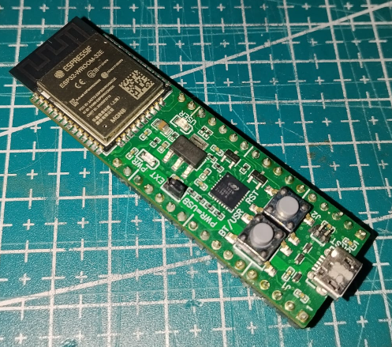 | **SSN32** (ESP32-WROOM-32E dev board) | 1 | Module 1 |
|  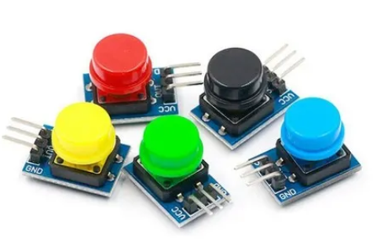 | **Push button**: a 4-leg tactile switch **or** a 3-pin module (GND / VCC / OUT). Either works | 1 | Module 2 |
| 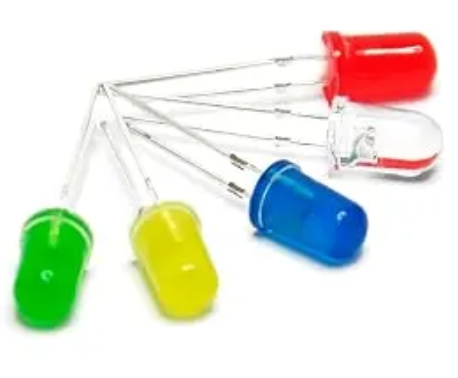 | **LED** (5 mm) | 1 | Module 2 |
| 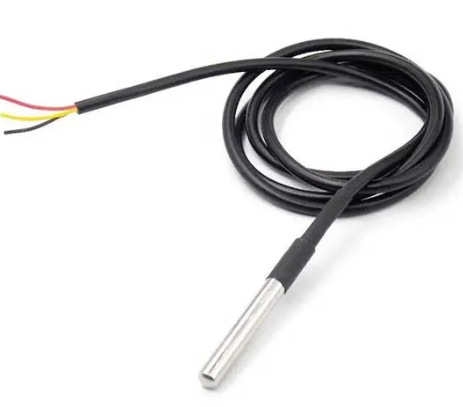 | **DS18B20** temperature sensor (waterproof probe, 1-Wire) | 1 | Module 3 |
| 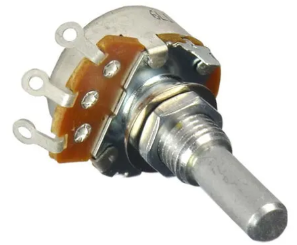 | **Potentiometer**: a rotary knob **or** a blue 3296 multi-turn trimmer. Either works | 1 | Module 3 |
| 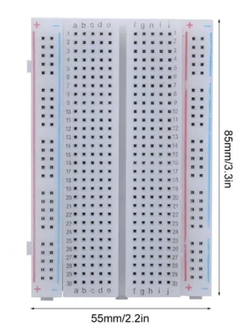 | **Breadboard** (400-tie, 55 × 85 mm) | 1 | Module 2 |
| 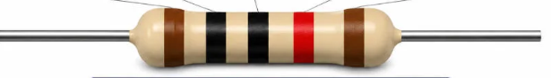 | **Resistor 10 kΩ** (for the LDR / thermistor bonus) | 1 | Module 3 |
| 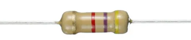 | **Resistor 4.7 kΩ** (DS18B20 pull-up) | 1 | Module 3 |
| 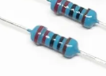 | **Resistor 220 Ω** (LED current limit) | 1 | Module 2 |
| 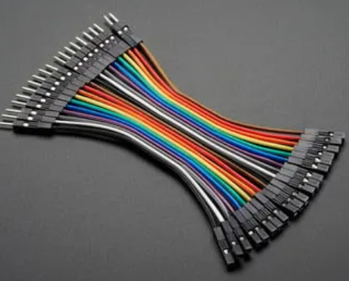 | **Jumper wires, male–female, short** | 6 | Module 2+ |
| 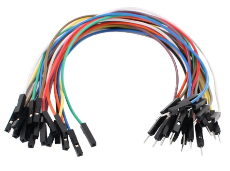 | **Jumper wires, male–female, long** | 3 | Module 2+ |
| 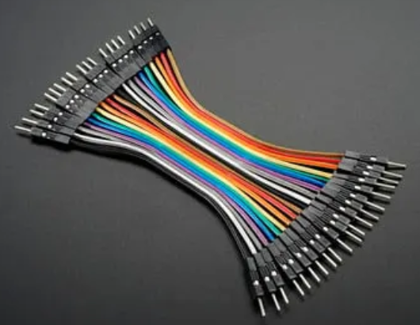 | **Jumper wires, male–male, short** | 13 | Module 2+ |
| 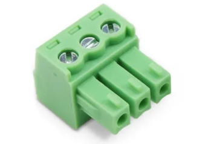 | **3-pin pluggable screw terminal** (DS18B20 wiring) | 1 | Module 3 |

**Notes**
- **4.7 kΩ** is the DS18B20 pull-up value from its datasheet. Some kits contain **5.1 kΩ** instead (colour bands green-brown-…): it works exactly the same, use it.
- The **220 Ω** resistor protects the LED in Module 2 (see the Ohm's-law wiring in [module-02-gpio](module-02-gpio.md)).
- The screw terminal lands the DS18B20's three flying leads onto breadboard jumpers cleanly.
- **Extra parts** (if your kit has the bigger component pack): LDR, NTC thermistor, active buzzer, RGB LED, 4N35 optocoupler, transistors. You don't need them for the labs; Modules 2 and 3 show what each one is for, and the LDR and thermistor are a Module 3 bonus.

**You also need (not in the kit):**
- A **USB data cable** for the SSN32 (Micro-USB on the board side). ⚠ Many cheap cables are **charge-only** and carry no data: the board lights up but the computer never sees it. If in doubt, use the cable that came with a phone.
- On a Mac (or laptop) with **only USB-C ports**: a USB-C to Micro-USB cable, or a USB-C adapter.
- About **3 GB of free disk space** and an account that is allowed to install programs (admin rights).

---

## 1. Install VS Code (the code editor)

VS Code is the program you write code in. PlatformIO (Section 2) runs inside it.

### Windows
1. Go to `code.visualstudio.com` and click **Download for Windows**.
2. Run the downloaded `VSCodeUserSetup-….exe`. Accept the agreement and keep the default options (leave **Add to PATH** ticked).
3. Click **Finish**. VS Code opens.

### Mac
1. Go to `code.visualstudio.com` and click **Download for macOS** (the "Universal" version works on both Intel and Apple-silicon Macs).
2. Open your **Downloads** folder. The download unzips itself into **Visual Studio Code.app**.
3. Drag **Visual Studio Code.app** into your **Applications** folder.
4. Open it from Applications. If macOS says it was downloaded from the Internet, click **Open**.

---

## 2. Install PlatformIO (the build tool)

PlatformIO turns your code into firmware and uploads it to the board.

### Mac only: check Python first
PlatformIO needs Python 3. Open **Terminal** (press `Cmd + Space`, type `Terminal`, press Enter) and type:
```
python3 --version
```
- If it prints `Python 3.x.x`, you're ready.
- If a window asks to install the **command line developer tools**, click **Install**, wait for it to finish (5–15 min), then run the command again.

### Windows only: check your user folder name
Open **File Explorer** and go to `C:\Users`. If **your** folder name contains non-English letters (for example Thai or Lao script), PlatformIO will fail to install. Fix it first:
1. Create a folder `C:\.platformio`.
2. Press the **Start** button, type `environment`, open **Edit environment variables for your account**.
3. Under *User variables*, click **New…**. Name: `PLATFORMIO_CORE_DIR`. Value: `C:\.platformio`. Click **OK** twice.
4. Close and reopen VS Code.

(Spaces in the name are fine. English letters only? Skip this.)

### Both: install the extension
1. In VS Code, open the **Extensions** panel: the four-squares icon on the left bar, or `Ctrl+Shift+X` (Windows) / `Cmd+Shift+X` (Mac).
2. Search **PlatformIO IDE**. Click **Install** on the one published by **PlatformIO**.
3. Wait. The bottom-right corner shows *Installing PlatformIO Core…*. This takes **2–10 minutes**. Don't close VS Code.
4. When it asks you to **Reload** or restart VS Code, do it.
5. Check it worked: an **ant-head icon** appears on the left bar and a **house icon** (PlatformIO Home) in the blue bar at the bottom.

---

## 3. Connect the SSN32 and check the computer sees it

The SSN32 talks to your computer through a small USB-to-serial chip on the board (a **CP2102** or a **CH340**, the name is printed on the chip near the USB socket). Your computer needs a driver for it.

### Windows
1. Plug the SSN32 in with your data cable.
2. Right-click the **Start** button and choose **Device Manager**.
3. Open **Ports (COM & LPT)**. You should see one of:
   - `Silicon Labs CP210x USB to UART Bridge (COM3)`
   - `USB-SERIAL CH340 (COM4)`

   The **COM number** is your board's port (it can be any number). ✅ Done, go to Section 4.
4. If there is no **Ports** entry, or the board appears under **Other devices** with a yellow ⚠, install the driver:
   - **CP2102:** search "CP210x USB to UART Bridge VCP drivers" on the **Silicon Labs** website, download the Windows driver, unzip it and run the installer (`…x64.exe`).
   - **CH340:** search "CH341SER" on the **WCH** website, download `CH341SER.EXE`, run it and click **INSTALL**.

   Unplug the board, plug it back in and check Device Manager again.
5. Still nothing, and no sound when you plug in? It's almost always a **charge-only cable**. Try another cable and another USB port (not a hub).

### Mac
1. Plug the SSN32 in with your data cable.
2. In **Terminal**, type:
   ```
   ls /dev/cu.*
   ```
3. You should see a line like `/dev/cu.usbserial-0001`, `/dev/cu.SLAB_USBtoUART` or `/dev/cu.wchusbserial…`. ✅ That's your board, go to Section 4. (`/dev/cu.Bluetooth-Incoming-Port` is not your board.)
4. If you only see Bluetooth entries, install the driver:
   - **CP2102:** search "CP210x USB to UART Bridge VCP drivers" on the **Silicon Labs** website, download the macOS driver and install it.
   - **CH340:** recent macOS versions include it. If it's still missing, search "CH34x macOS driver" on the **WCH** website and install it.

   Then open **System Settings → Privacy & Security**. If you see *"System software from developer … was blocked"*, click **Allow** and restart the Mac.
5. Still nothing? Try another cable (charge-only cables are the usual cause) and plug directly into the Mac or a known-good adapter.

---

## 4. Download the course code (ZIP)

You don't need Git or any GitHub account. You download the whole course once as a ZIP file.

1. In your web browser open `github.com/sensornodeiot/AIoT-Next-GEN-Bootcamp`.
2. Click the green **`<> Code`** button, then **Download ZIP**. You get `AIoT-Next-GEN-Bootcamp-main.zip`.

### Windows: unzip to `C:\IoT`
1. Open your **Downloads** folder, **right-click** the ZIP and choose **Extract All…**.
2. Change the destination to `C:\IoT` and click **Extract**.
3. Rename the new folder `AIoT-Next-GEN-Bootcamp-main` to **`AIoT-Next-GEN-Bootcamp`**. Final location: `C:\IoT\AIoT-Next-GEN-Bootcamp`.

⚠ **Don't** just double-click the ZIP and work from inside it: Windows only shows you a preview, and nothing will build. **Don't** use your Desktop or Documents if they are synced to OneDrive.
*Why `C:\IoT`:* building ESP32 code creates very long file paths, and Windows has a limit on path length. A short folder near the top of the drive avoids strange build errors.

### Mac: unzip to an `IoT` folder in your home folder
1. Open your **Downloads** folder and **double-click** the ZIP. A folder `AIoT-Next-GEN-Bootcamp-main` appears.
2. In Finder press `Cmd + Shift + H` to go to your home folder, and create a new folder called **`IoT`**.
3. Drag the `AIoT-Next-GEN-Bootcamp-main` folder into `IoT` and rename it to **`AIoT-Next-GEN-Bootcamp`**. Final location: `~/IoT/AIoT-Next-GEN-Bootcamp`.

⚠ Avoid Desktop or Documents if they are synced to iCloud Drive: syncing fights with the thousands of files a build creates.

### What's inside

```
AIoT-Next-GEN-Bootcamp/
├── docs/                             ← all the written lessons
├── module-01-mcu-toolchain-serial/   ← Modules 1–4: one starter project each
├── module-02-gpio/
├── module-03-sensors/
├── module-04-firmware-patterns/
├── sensorclouds-template/            ← Modules 5–10: the complete SSC device
└── appendix-low-level/               ← optional "under the hood" versions of 5–10
```

*(Modules 0 and 8 have no firmware: Module 0 is this setup, Module 8 is dashboard work on the Sensorclouds website.)*

---

## 5. Open a module in PlatformIO

You always open **one module folder** at a time, the one you're working on.

1. In VS Code, click the **house icon** (PlatformIO Home) in the blue bar at the bottom. (Or: ant icon on the left → **PIO Home → Open**.)
2. On the PlatformIO Home page, under *Quick Access*, click **Open Project**.
3. Browse to the module folder, for example:
   - Windows: `C:\IoT\AIoT-Next-GEN-Bootcamp\module-01-mcu-toolchain-serial`
   - Mac: `/Users/<your name>/IoT/AIoT-Next-GEN-Bootcamp/module-01-mcu-toolchain-serial`
4. Click the blue **Open "module-01-mcu-toolchain-serial"** button.
5. If VS Code asks *"Do you trust the authors of the files in this folder?"*, click **Yes, I trust the authors**.
6. **First time only:** PlatformIO now downloads the ESP32 tools (several hundred MB). Watch the bottom-right corner and wait until it finishes (5–20 min).

*(Also works: **File → Open Folder…** and pick the same module folder.)*

> **The rule:** open the **module folder itself**, the one with `platformio.ini` directly inside it. Never open the whole `AIoT-Next-GEN-Bootcamp` folder: PlatformIO won't find a project and the build buttons won't appear.

To move to another module later, repeat steps 1–4 with the next folder (or use **File → Open Recent**).

---

## 6. First upload: prove everything works

Do this with `module-01-mcu-toolchain-serial` open and the SSN32 plugged in.

The blue bar at the bottom of VS Code has the PlatformIO buttons:

| Button | Name | What it does |
|:------:|------|--------------|
| ✓ | **Build** | Compiles your code (checks it, makes the firmware) |
| → | **Upload** | Builds, then copies the firmware onto the board |
| 🔌 | **Serial Monitor** | Shows what the board prints |
| 🗑 | **Clean** | Deletes old build files (use if a build acts strangely) |

1. Click **✓ Build**. A terminal opens and ends with **`[SUCCESS]`** in green.
2. Click **→ Upload**. You'll see `Connecting....` then a percentage counting up, and **`[SUCCESS]`**.
3. Click **🔌 Serial Monitor**.
4. Press the **EN** button on the SSN32 (it restarts the board). You should see:
   ```
   SSN32 ready.
   ```
✅ Your computer, cable, driver and PlatformIO all work. You're ready for Module 1.

PlatformIO finds the board's port by itself. Every project in this course uses a Serial speed of **115200** (set in `platformio.ini` as `monitor_speed`), so you never have to choose it.

*Optional: the same actions from a terminal.* Open **PlatformIO: New Terminal** (ant icon → Miscellaneous) and type `pio run` (build), `pio run -t upload` (upload) or `pio device monitor` (monitor).

---

## 7. Modules 5–10: the Sensorclouds template

**All of Modules 5–10 use the same project: `sensorclouds-template`.** Open it exactly like Section 5 (pick the `sensorclouds-template` folder) and use the same Build / Upload / Serial Monitor buttons.

The template is already complete. It publishes all the course parts (temperature, potentiometer, button and LED) every 10 seconds, so there is **no code to write** to get online:

- **Module 5**: upload it and set it up in your browser (Wi-Fi + Sensorclouds details). The device comes online.
- **Module 7**: wire the DS18B20, potentiometer and button. Their values appear on Sensorclouds.
- **Module 9**: send commands from Sensorclouds (switch the LED, change the publish interval).
- **Module 10**: change `FIRMWARE_VERSION` and update the board over the air.

The first time you upload it, the board has no settings yet, so it creates its own Wi-Fi network called `SSN32-Config`. [module-05-ssc-client](module-05-ssc-client.md) walks you through it.

---

## 8. Module → folder reference

| Module | Open this folder | You do |
|--------|------------------|--------|
| 0 | *(none)* | this setup guide |
| 1 | `module-01-mcu-toolchain-serial` | fill in `src/main.cpp` |
| 2 | `module-02-gpio` | fill in `src/main.cpp` |
| 3 | `module-03-sensors` | fill in `src/main.cpp` |
| 4 | `module-04-firmware-patterns` | split the code into files |
| **5–10** | **`sensorclouds-template`** | upload, set up in the browser, wire parts, send commands |
| 8 | *(none)* | dashboard work on the Sensorclouds website |
| Appendix | `appendix-low-level/module-0X-…` | optional hand-coded versions |

---

## 9. Troubleshooting

| What you see | Cause | Fix |
|---|---|---|
| No COM port (Windows) / no `/dev/cu.usb…` (Mac) | Charge-only cable, missing driver, or a bad USB hub | Try another cable first, then install the driver (Section 3), plug in directly |
| Upload stops at `Connecting........_____` | The board didn't enter upload mode by itself | **Hold the BOOT button** on the SSN32, click **Upload** again, release BOOT when the percentage starts |
| `Could not open port` / `Access is denied` / `port is busy` | Another program is using the port | Close the Serial Monitor (trash-can icon on its terminal), the Arduino IDE or any other serial program, then upload again |
| Serial Monitor shows garbage like `⸮⸮⸮` | Wrong speed | Make sure `platformio.ini` has `monitor_speed = 115200` and the code uses `Serial.begin(115200)` |
| No build/upload buttons, or `Not a PlatformIO project` | You opened the parent folder | Open the **module folder** itself (Section 5) |
| PlatformIO install never finishes or mentions Python | Python missing (Mac) or a non-English user folder (Windows) | Do the "Mac only" / "Windows only" step in Section 2, then restart VS Code |
| Build fails with very long paths or `No such file or directory` deep in `.pio` (Windows) | Project folder is too deep or synced | Move the course to `C:\IoT` (Section 4) and click **Clean**, then **Build** |
| Mac: driver installed but still no port | macOS blocked the driver | System Settings → Privacy & Security → **Allow**, then restart |

---

## 10. Getting an updated version of the course

If your instructor announces an update, download the ZIP again (Section 4) and extract it to a **new** folder, for example `C:\IoT\AIoT-Next-GEN-Bootcamp-v2`. Don't extract over your old folder, or you'll lose your own code. Copy across only the files you changed.

---

## 11. For the instructor

- **Send Sections 1–6 as homework** before day 1 and ask everyone to bring a screenshot of `SSN32 ready.` in the Serial Monitor. That proves the cable, driver and PlatformIO work, and the large ESP32 download happens at home.
- Bring **spare data cables** and a few **USB-C adapters** for Mac users.
- For Modules 5–10: **register each student's device in Sensorclouds beforehand**, and paste the template decoder (`sensorclouds-template/docs/platform/decoder.md`) into each device before Module 7.
- The course repo is **public**, so the ZIP download needs no GitHub account.

