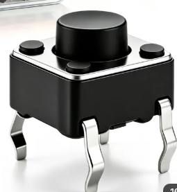
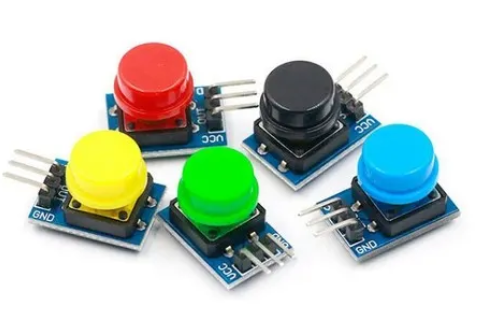
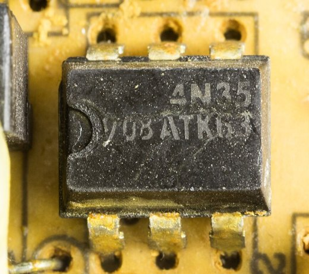
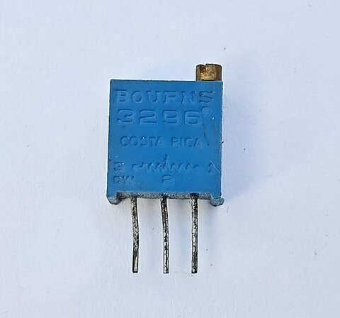
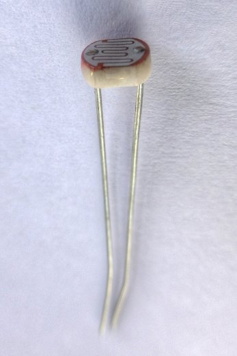
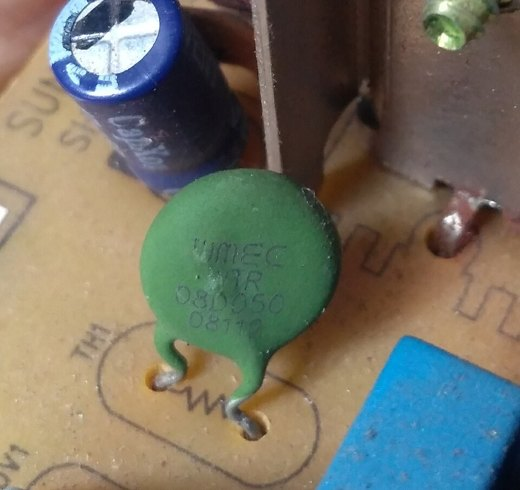
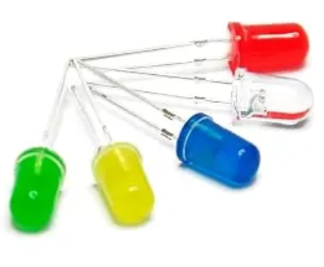
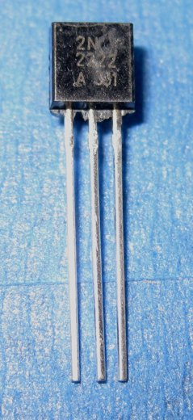
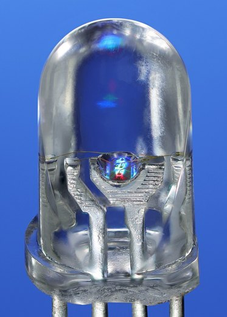

# Swap Your Parts — Any Part That Fits the Role

**What this is:** a reference page for every lab from Module 2 on. The labs name one part (a potentiometer, a 4-leg switch, an LED), but **you are never stuck with that part**. Any part that does the same *job* works on the same pin, usually with no code change. This page lists what fits each job, how to wire it, and the one thing (if any) you change.

---

## 1. The big idea: a pin only sees a voltage

A GPIO pin on your SSN32 (or any ESP32 board in the course) doesn't know what is connected to it. An input pin sees a voltage, and an output pin makes one. That's all.

- If a knob makes 0–3.3 V on GPIO 34, the code reads a percentage. If a light sensor makes 0–3.3 V on GPIO 34, the code reads a percentage too, **the same code**.
- If a button joins GPIO 4 to GND, the code sees LOW. A different button that joins GPIO 4 to GND looks exactly the same.
- If GPIO 2 goes HIGH, whatever is on it turns on: an LED lights, or (through a transistor) a buzzer beeps.

So the code is written for a **role**, not for a part. The course uses four roles, one pin each:

| Role | Pin | What the pin sees or makes | Parts in your kit that fit | What you change |
|------|-----|----------------------------|----------------------------|-----------------|
| **On/off input** (digital in) | GPIO 4 | HIGH or LOW | 4-leg tactile switch, 3-pin button module, 4N35 optocoupler | Module 2: the `PRESSED` line. Template: nothing |
| **Varying input** (analog in) | GPIO 34 | Any voltage from 0 to 3.3 V | Potentiometer (knob), 3296 multi-turn trimmer, LDR + 10 kΩ, NTC thermistor + 10 kΩ | Nothing. Only what the % *means* changes |
| **On/off output** (digital out) | GPIO 2 | Makes 3.3 V or 0 V | LED + 220 Ω, active buzzer through a transistor, a common-cathode RGB LED | Nothing |
| **Digital sensor** (1-Wire bus) | GPIO 32 | Coded messages | DS18B20 only | Can't swap with an analog part (Section 6) |

> **The rule:** swap a part for another part **in the same role**, and the code keeps working. Swap it for a part in a **different** role (an NTC thermistor in place of the DS18B20), and it won't: the pin is expecting a different kind of signal.

---

## 2. Before you try a new part: three questions

Ask these about any part, from the kit or from anywhere else:

1. **Which role is it?** Does it give on/off, a varying voltage, or coded data? Or does it need to be switched on and off? That tells you the pin.
2. **What voltage does it put on the pin?** Never more than **3.3 V**. A part powered from 5 V can send 5 V back into the pin and damage it.
3. **How much current does it need?** A GPIO pin gives about **20 mA** at most. An LED needs ~6 mA: fine. A buzzer, relay or motor needs more: use a **transistor** (Section 5).

Then **test it on its own first**: print `digitalRead()` or `analogRead()` to Serial and watch the number while you press, turn, cover or warm the part. If the number moves the way you expect, the part works and the rest of the code will work with it.

---

## 3. On/off input — GPIO 4

Everything here joins GPIO 4 to something (GND, or 3.3 V) while it is "on". The pin uses `INPUT_PULLUP`, so it rests HIGH when nothing is joined.

| Part | Wiring | Reads when pressed / on |
|------|--------|-------------------------|
|  **4-leg tactile switch** | Across the breadboard's centre gap. One leg → GPIO 4, the **diagonally opposite** leg → GND | **LOW** |
|  **3-pin button module** (GND / VCC / OUT) | VCC → 3.3 V, GND → GND, OUT → GPIO 4 | **HIGH** (most modules; check yours) |
|  **4N35 optocoupler** (advanced) | Input side: the signal → 220 Ω → pin 1 (next to the dot), pin 2 → GND. Output side: pin 5 → GPIO 4, pin 4 → GND | **LOW** while the input side has a signal |

**What to change in code:**
- **Module 2** (your own code): one line. `#define PRESSED LOW` for the 4-leg switch or the optocoupler, `#define PRESSED HIGH` for the 3-pin module. Not sure? Print `digitalRead(4)` while you press.
- **Template (Modules 5–10):** nothing. At power-up it checks which way GPIO 4 rests and treats the opposite as "pressed". Just don't hold the button while the board starts.

**4-leg switch tip:** the four legs are joined in pairs inside. If it reads "pressed" all the time, or never, your two wires are on the same pair. Use diagonal legs.

**Why the optocoupler is here:** in a real building the "on" signal often comes from a machine at 12–24 V ("motor running", "door closed"), which would destroy a 3.3 V pin. The 4N35 passes the signal across as light, with **no wire between the two sides**. To try it in class, use 3.3 V and the 220 Ω as the "machine signal": touch the 220 Ω end to 3.3 V and the input reads LOW. (In this demo both sides share the board's GND, so it isn't isolated yet; in a real installation the input side gets its own GND.) A real 12–24 V signal needs a bigger resistor with a higher power rating: ask your instructor before you connect one. Pin 1 is next to the dot on the chip.

---

## 4. Varying input — GPIO 34

The ADC reads a voltage between 0 and 3.3 V and the code turns it into 0–100 %. Any part that makes a voltage in that range works.

| Part | Wiring | Extra part | What 0 → 100 % means |
|------|--------|-----------|----------------------|
|  **Potentiometer** (knob) | Outer legs → 3.3 V and GND, middle leg (wiper) → GPIO 34 | None | How far it's turned |
|  **3296 trimmer** (blue box, brass screw) | Same: outer pins → 3.3 V and GND, middle pin → GPIO 34 | None | How far the screw is turned (~25 turns end to end, no end stop) |
|  **LDR** (light sensor) | 3.3 V → LDR → GPIO 34 → 10 kΩ → GND | **10 kΩ** | Dark → bright |
|  **NTC thermistor** | 3.3 V → NTC → GPIO 34 → 10 kΩ → GND | **10 kΩ** | Cold → warm (a trend, not °C) |

**Why the pot needs no resistor and the LDR does:** the ADC needs a *voltage divider*: two resistances between 3.3 V and GND, with the pin in the middle. A potentiometer is already both halves (the wiper slides along one long resistor). An LDR or NTC is only *one* resistance that changes, so the fixed 10 kΩ is the other half. Swap the LDR and the 10 kΩ around and the reading runs the other way (bright → low). That's fine, just read it the other way round.

**What to change in code:** nothing, in any module. In the template the value is still published as **`pot`**, because the template can't know what you plugged in. On your dashboard (Module 8), just give the widget a better title, e.g. "Light level". If you want the payload itself to say `light`, rename it in `sensor.cpp` **and** in the decoder's `NAMES` list, keeping it in the **same position** (second). Then re-point your Module 8 gauge to the new `light` channel: the old `pot` channel stops getting data.

---

## 5. On/off output — GPIO 2

When GPIO 2 goes HIGH, whatever is on it turns on. On all three course boards, GPIO 2 also drives an on-board LED, so that one always blinks along.

| Part | Wiring | Why |
|------|--------|-----|
|  **LED** | GPIO 2 → 220 Ω → LED long leg; short leg → GND | 220 Ω keeps the current to ~6 mA |
|  **Active buzzer** (Digisound F/TCW05) | Through a **2N2222A** transistor: GPIO 2 → 5.1 kΩ → base; buzzer `+` → 3.3 V (or 5 V), buzzer `−` → collector; emitter → GND; 1N4007 across the buzzer, stripe towards `+` | The buzzer takes up to 30 mA, more than a pin should give. The pin only switches the transistor (< 1 mA) |
|  **RGB LED, common-cathode type** | Long leg → GND; one colour leg → 220 Ω → GPIO 2 | Lights on HIGH, like the LED. **Don't use a common-anode RGB LED on GPIO 2**: its long leg goes to 3.3 V, which pulls GPIO 2 up while the board starts and can stop uploads (GPIO 2 helps choose the boot mode) |

The full buzzer circuit, with the transistor's leg order (E B C, flat face towards you), is in [module-02-gpio](module-02-gpio.md) ("Swap the output — make it beep").

**What to change in code:** nothing. In Module 2 your blink becomes a beep. In Module 9, `config:set_led` with `{ "state": 1 }` turns the buzzer **on from the cloud**: a remote alarm.

> **The pattern to remember:** if a part needs more current than a pin can give (buzzers, relays, motors, LED strips), **the pin switches a transistor, and the transistor switches the part.** If the part has a coil (buzzer, relay, motor), add the diode.

---

## 6. Digital sensor — GPIO 32

The DS18B20 doesn't send a voltage that means something. It sends **coded messages** over 1-Wire, and the `DallasTemperature` library decodes them into °C. So this role has no simple swap in your kit:

- The **NTC thermistor** also senses temperature, but it's an **analog** part: it gives a varying voltage, not coded messages. On GPIO 32 the library finds no sensor. Put it on GPIO 34 instead (Section 4), where it works as a varying input.
- **Another DS18B20** fits the same wire: each one has its own built-in address, so several can share one pin. But the course code reads only the first sensor it finds, so reading two needs a small code change (`getTempCByIndex(1)` for the second).

This is the clearest example of the rule in Section 1: same *thing measured* (temperature), different *role*, so a different pin and different code.

---

## 7. Troubleshooting a swapped part

| Symptom | Likely cause | Fix |
|---------|--------------|-----|
| Button reads "pressed" all the time (or never) | Wrong `PRESSED` level, or (4-leg switch) both wires on one pair | Swap `PRESSED`; use diagonal legs |
| Template: `button` is always `1` | The part was "on" while the board started | Release it, press **EN** |
| LDR or NTC reads 0 % or 100 % and never moves | The 10 kΩ is missing, so it isn't a divider | Add the 10 kΩ from GPIO 34 to GND |
| LDR reading runs the "wrong" way | LDR and 10 kΩ are swapped | Fine as it is; or swap them |
| Buzzer silent | Transistor legs in the wrong order, or a PNP part | Flat face towards you: E B C. Use an NPN (2N2222A, S8050) |
| Uploads fail (`Connecting…` never finishes) after adding an RGB LED | A common-anode RGB LED on GPIO 2 holds the pin up while the board starts | Use a common-cathode RGB LED (long leg to GND), or the plain LED |
| DS18B20 not found after swapping in the NTC | Different role | NTC goes on GPIO 34 with the 10 kΩ |

---

## Where each lab uses this

- [module-02-gpio](module-02-gpio.md): on/off input (GPIO 4) and on/off output (GPIO 2)
- [module-03-sensors](module-03-sensors.md): varying input (GPIO 34) and the digital sensor (GPIO 32)
- [module-07-publish-telemetry](module-07-publish-telemetry.md): all four roles on the template
- [module-09-receive-commands](module-09-receive-commands.md): the output role, switched from the cloud

